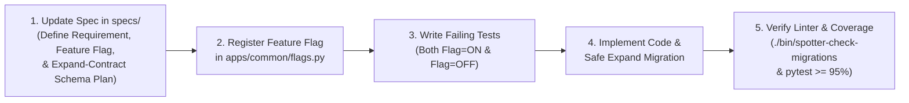

# AI Agent & Developer Instructions (`AGENTS.md`)

> [!IMPORTANT]
> **Spec-Driven Development (SDD) — `specs/` is the Single Source of Truth**
> This repository is built and maintained strictly using **Spec-Driven Development (SDD)**. The specification files in [`specs/`](./specs/README.md) are the authoritative **Single Source of Truth** for all architecture, data models, algorithms, feature flags, and database migration safety rules.
>
> **Never write application code, add a feature, or generate a database migration without first reading and updating the corresponding specification in `specs/`.**

---

## 1. Authoritative Specification Index (`specs/`)

Before planning or implementing any change, consult the master index in [`specs/README.md`](./specs/README.md) and the relevant domain specification:

| Spec ID | File | Scope & Source-of-Truth Responsibility |
| :--- | :--- | :--- |
| **Index** | [`specs/README.md`](./specs/README.md) | Master SDD Governance Rules, Requirement Traceability Matrix, and Architecture Decision Records (`ADR-001` – `ADR-006`). |
| **Spec 01** | [`specs/01-system-architecture.md`](./specs/01-system-architecture.md) | C4 containers, Django 6.0 / Python 3.12 runtime, Redis caching, and `<= 1` external OSRM call invariant. |
| **Spec 02** | [`specs/02-data-pipeline-and-schema.md`](./specs/02-data-pipeline-and-schema.md) | `FuelStation` PostGIS model, ETL deduplication, and **Section 6: Expand-Contract Database Schema Rules (`REQ-OPS-005`)**. |
| **Spec 03** | [`specs/03-spatial-corridor-and-dp-optimizer.md`](./specs/03-spatial-corridor-and-dp-optimizer.md) | PostGIS spatial corridor filter (`ST_DWithin` + `ST_LineLocatePoint`) and $O(N \log N)$ Monotonic Queue DP algorithm. |
| **Spec 04** | [`specs/04-api-contract-and-validation.md`](./specs/04-api-contract-and-validation.md) | `POST /api/v1/routes/optimize/` request/response schemas and RFC 7807 error contracts. |
| **Spec 05** | [`specs/05-testing-and-tdd-strategy.md`](./specs/05-testing-and-tdd-strategy.md) | Red-Green-Refactor TDD workflow and $\ge 95.0\%$ coverage gate (`--cov-fail-under=95`). |
| **Spec 06** | [`specs/06-ui-and-frontend-integration.md`](./specs/06-ui-and-frontend-integration.md) | MapLibre GL JS + Deck.gl WebGL UI and WCAG AAA contrast compliance. |
| **Spec 07** | [`specs/07-zero-to-production-and-load-testing.md`](./specs/07-zero-to-production-and-load-testing.md) | Zero-to-Production wizard (`./bin/spotter-deploy`), Route 53 & Namecheap DNS automation, and Locust stress testing. |
| **Spec 08** | [`specs/08-feature-flags-and-zero-downtime-database-migrations.md`](./specs/08-feature-flags-and-zero-downtime-database-migrations.md) | **Feature Flag Catalog (`apps/common/flags.py`), Multi-Layer Rollback Architecture (`./bin/spotter-rollback`), and Zero-Downtime Migration Linter (`./bin/spotter-check-migrations`)**. |
| **Spec 09** | [`specs/09-developer-rules-and-system-integrity.md`](./specs/09-developer-rules-and-system-integrity.md) | Mandatory developer & agent integrity rules and CI enforcement gates. |

---

## 2. Mandatory SDD Workflow for Every Change



1. **Spec First (`specs/`)**:
   - Update the relevant specification in `specs/` **before** modifying application code.
   - Document the new/updated Requirement ID (`REQ-*`), the controlling **Feature Flag** name and rollback behavior, and (if touching models) the **Expand-Contract** migration phase.
2. **Feature Flag First for Effortless Feature Rollback ([Spec 08](./specs/08-feature-flags-and-zero-downtime-database-migrations.md))**:
   - Every behavioral, algorithmic, or API change must be gated behind a feature flag registered in [`apps/common/flags.py`](./apps/common/flags.py) (`DEFAULT_FLAGS`).
   - Why? So any feature can be rolled back in **$< 0.1\text{ s}$** via `./bin/spotter-feature-flag disable <flag_name>` without redeploying containers or touching the database.
   - Unit tests must test both `flag=True` (new behavior) and `flag=False` (safe fallback behavior).
3. **Strict Expand-Contract Database Schema Rules ([Spec 02 §6](./specs/02-data-pipeline-and-schema.md) & [Spec 08 §3](./specs/08-feature-flags-and-zero-downtime-database-migrations.md))**:
   - Because rolling back a production PostgreSQL/PostGIS database containing live data is dangerous and impractical, **all schema changes must be 100% backward-compatible with the currently running production code (`v1`)**.
   - Never drop a column (`RemoveField`), drop a table (`DeleteModel`), rename a column/table (`RenameField`/`RenameModel`), add a non-nullable column without a default, or build a blocking index in the same release as an application change.
   - Always run `./bin/spotter-check-migrations` (`RULE-MIG-01` through `RULE-MIG-06`) before committing. This guarantees that rolling back application containers (`./bin/spotter-rollback`) works cleanly against the already-migrated database without running `migrate` backwards.

---

## 3. Essential Commands (Use `.venv/bin/python`)

```bash
# 1. Validate zero-downtime database migration safety (RULE-MIG-01 .. RULE-MIG-06)
./bin/spotter-check-migrations

# 2. Run unit tests with the mandatory >= 95% coverage gate
.venv/bin/pytest tests/unit/ -m unit --cov=apps --cov-report=term-missing --cov-fail-under=95

# 3. Inspect or toggle feature flags
./bin/spotter-feature-flag list
./bin/spotter-feature-flag disable <flag_name>

# 4. Perform application rollback (Canary abort / Blue-Green flip / K8s undo / Compose tag revert)
./bin/spotter-rollback --target k8s-blue-green --dry-run
```
