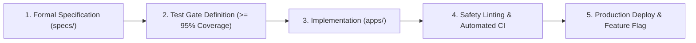
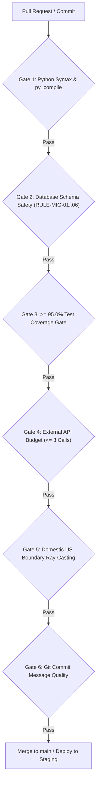

# Developer Contributing Guide & System Integrity Rules

> **Audience**: All software engineers, DevOps practitioners, and contributors working on the **Spotter Fuel Route Optimizer**.  
> **Mission**: Deliver a deterministic, sub-15ms, zero-downtime, production-grade fuel optimization platform with unbroken system integrity.

---

## 1. Engineering Philosophy: Spec-Driven Development (SDD)

This repository operates strictly under **Spec-Driven Development (SDD)**. 



1. **Specs are Source of Truth**: Before writing or modifying code in `apps/`, the architectural intent, data schemas, API contracts, and failure boundaries must be documented in [`specs/`](specs/).
2. **No Spec Drift**: If requirements or algorithm heuristics change during development, the corresponding specification document **must be updated in the same pull request**.

---

## 2. Non-Negotiable Quality Gates & System Integrity Rules

Every code submission must comply with the following 6 core gates. Violations will automatically block pull request merges in GitHub Actions CI.



### Gate 1: Python Syntax & py_compile
- After making changes to any Python file, verify that it compiles cleanly with zero syntax errors:
  ```bash
  python -m py_compile <filename>
  ```
- All functions and class methods must include strict Python type hints.

### Gate 2: Zero-Downtime Database Migration Safety (Expand-Contract)
Because rolling back migrations with large live datasets causes table locks, schema corruption, and data loss:
- **`RULE-MIG-01` (No Non-Nullable Columns without Defaults)**: Never add a `NOT NULL` column without an explicit `default=...`.
- **`RULE-MIG-02` (No Direct Column Removals)**: Never remove fields (`migrations.RemoveField`) in an active release. Follow Expand-Contract: (1) stop reading/writing the field in code, (2) deploy, (3) drop field in a subsequent release.
- **`RULE-MIG-03` (No Column/Model Renames)**: Never use `RenameField` or `RenameModel`. Add the new column, dual-write in code, backfill data, and drop the old column later.
- **`RULE-MIG-04` (No Destructive SQL)**: Raw SQL with `DROP TABLE`, `DROP COLUMN`, or `TRUNCATE` is strictly forbidden.
- **Verification Command**:
  ```bash
  ./bin/spotter-check-migrations
  # or
  python manage.py check_migration_safety --fail-on-warning
  ```

### Gate 3: Test Quality & Coverage Gate ($\ge 95.0\%$)
- Unit and integration test coverage across `apps/` must never fall below **$95.0\%$**:
  ```bash
  pytest tests/ --cov=apps --cov-branch --cov-report=term-missing --cov-fail-under=95
  ```
- All tests must pass with a **100% pass rate** (zero failures, zero regressions).
- Unit tests must mock external networks; no real outbound HTTP calls or real DNS mutations are permitted during unit test execution.

### Gate 4: External API Call Budget Guard ($\le 3\text{ Calls}$)
- **Offline-First Priority**: The pre-seeded local US gazetteer (65,920 Census places and ZIP codes) must resolve $>99\%$ of city and ZIP queries with **0 external API calls**.
- All external routing and geocoding requests are gated by `ExternalCallBudget`. Never increase or bypass the hard limit of **$\le 3$ external calls per route request**.

### Gate 5: Strict Domestic US Boundary Enforcement
- All route origins, destinations, and intermediate polyline steps must be validated by the ray-casting polygon boundary engine (`apps/routing/boundary.py`).
- Routes entering Canadian or Mexican territory (e.g. Ontario transit between Detroit and Buffalo) must be rejected with `LOCATION_OUTSIDE_USA`.

### Gate 6: Git Commit Message Quality
Commit messages must describe the **content change** (what was added, modified, or removed), not the action taken or working session details:
- ✅ `"Add Category and Title facet bar charts to browse page"`
- ✅ `"Add dynamic feature flags and zero-downtime migration safety linter"`
- ❌ `"Sync from dev server: latest browse.tt"`
- ❌ `"WIP fix tests"`
- ❌ `"Updates"`

---

## 3. Feature Flags & Decoupled Release Management

Never bind code deployment directly to user-facing feature exposure:
1. **Dynamic Feature Flags**:
   - Wrap new algorithms, providers, or experimental features with `flags.is_enabled("FEATURE_NAME", key=user_id)`.
   - Configure percentage rollouts via deterministic consistent hashing in [`apps/common/flags.py`](apps/common/flags.py).
2. **Instant Kill-Switch**:
   - If an issue occurs in production, disable the feature instantly via CLI without redeploying code or restarting containers:
     ```bash
     ./bin/spotter-feature-flag --set FEATURE_NAME off
     ```

---

## 4. UI Copy, Accessibility (a11y) & UX Standards

For maps, viewers, and user-facing endpoints:
1. **High Text Contrast**: Never use white or light gray text on light backgrounds. Ensure all body, summary, and informational texts use dark/black color (`#000000` or compliant theme tokens) to guarantee WCAG accessibility contrast.
2. **Branding Assets**: Use modern vector SVG icons rather than raster graphics.
3. **No Technical Jargon in UI Copy**: Never expose internal software engineering jargon (e.g. `"payload"`, `"hydration"`, `"JWT"`, `"endpoint"`, `"UUID"`, `"deeplink"`) or underlying cloud provider names to end users. Always use clear, customer-friendly terminology.

---

## 5. Local Development Workflow

### 5.1 Environment Setup
```bash
# Clone the repository
git clone git@github.com:aldian/fuel-route-optimizer.git
cd fuel-route-optimizer

# Activate virtual environment
source .venv/bin/activate

# Install dependencies
pip install -r requirements.txt

# Run migrations and seed data
python manage.py migrate
python manage.py load_fuel_stations
python manage.py load_us_gazetteer
```

### 5.2 Pre-Push Verification Checklist
Run these commands in order before opening a pull request:

```bash
# 1. Check Python syntax
python -m py_compile manage.py config/urls.py config/settings/*.py apps/*/*.py apps/common/*.py

# 2. Check Django system sanity
python manage.py check

# 3. Check Database migration zero-downtime safety
./bin/spotter-check-migrations

# 4. Check OpenAPI 3.1 specification schema
python manage.py spectacular --validate

# 5. Run full test suite with 95% coverage gate
pytest tests/ --cov=apps --cov-branch --cov-report=term-missing --cov-fail-under=95

# 6. Test Zero-to-Production Deploy Wizard dry run
./bin/spotter-deploy --target docker-vps --domain api.example.com --non-interactive --dry-run
```

---

## 6. Emergency Rollback Procedures

If an incident occurs in production, follow the established rollback hierarchy:

1. **Level 1 (Feature Issue)**: Toggle the feature flag off:
   ```bash
   ./bin/spotter-feature-flag --set FAULTY_FEATURE off
   ```
2. **Level 2 (Kubernetes Blue-Green Switch)**: Revert live traffic pointer to Blue (< 1s):
   ```bash
   ./deploy/k8s/overlays/blue-green/switch_traffic.sh blue production
   ```
3. **Level 3 (GitHub Actions 1-Click Rollback)**:
   - Navigate to GitHub Actions $\to$ **"Rollback Deployment (1-Click Emergency Rollback)"** $\to$ Run workflow.
4. **Level 4 (CLI Rollback)**:
   ```bash
   ./bin/spotter-rollback --target k8s --namespace production
   ```
