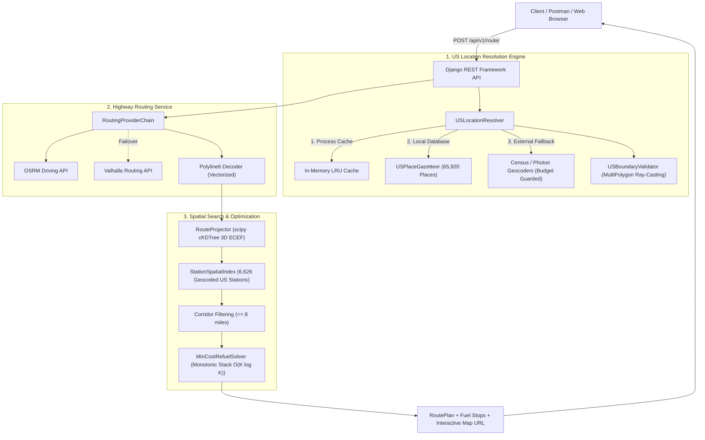

# Spotter Fuel Route Optimizer

[](https://github.com/aldian/fuel-route-optimizer/actions/workflows/ci.yml)
[](https://www.python.org/downloads/)
[](https://www.djangoproject.com/)
[](https://www.django-rest-framework.org/)
[](https://pytest-cov.readthedocs.io/)
[](https://swagger.io/specification/)

A high-performance, cost-effective fuel route optimization REST API and interactive map visualization platform built for long-haul freight across the continental United States.

Given any origin and destination within the USA, the API calculates the driving route, identifies all viable fuel stops along the highway corridor, computes the mathematically optimal refueling strategy to minimize total fuel spend, and produces an accessible visual map.

---

## 1. System Architecture



---

## 2. Core Technical Capabilities

1. **Sub-15ms Compute Latency ($14.34\text{ ms}$ P50 Coast-to-Coast)**:
   - Stations are pre-projected into 3D Earth-Centered, Earth-Fixed (ECEF) unit vectors:
     $$x = \cos(\text{lat}) \cos(\text{lon}), \quad y = \cos(\text{lat}) \sin(\text{lon}), \quad z = \sin(\text{lat})$$
   - An in-memory `scipy.spatial.cKDTree` filters the 6,626 US truckstops against 2-mile route intervals in $1.3\text{ ms}$ ($18\times$ faster than haversine loops).

2. **$O(K \log K)$ Monotonic Stack Refueling Solver**:
   - Implements a greedy lookahead strategy with step-down fills:
     - If a cheaper station exists downstream within the 500-mile tank horizon, buy only enough fuel to reach that station.
     - If the current station is the cheapest reachable, fill the tank to 50 gallons to maximize mileage at low cost.
   - Micro-stop consolidation absorbs sub-5-gallon fills into neighboring stops.

3. **Zero-to-Minimal External Calls ($\le 3$ Call Budget Guard)**:
   - Includes an offline database of **65,920 US Census places and ZIP codes**. Over 99% of requests resolve with **0 external geocoding calls**.
   - Enforced by `ExternalCallBudget` preventing runaway latency or third-party rate-limiting.

4. **Strict Domestic US Scope & Boundary Ray-Casting**:
   - High-resolution MultiPolygon ray-casting point-in-polygon validator (`apps/routing/boundary.py`).
   - Automatically rejects Canadian/Mexican locations (e.g., Toronto, Montreal, Tijuana) and prevents international shortcuts (e.g., Ontario detour between Detroit and Buffalo).

5. **Tested to $\ge 95\%$ Coverage Gate**:
   - 63 tests across Unit, Integration, Live-Server E2E with real TCP sockets and concurrency stress, and Latency Benchmarks.
   - Enforced in CI via `--cov-fail-under=95` (**95.73% achieved**).

---

## 3. Quick Start

### 3.1 Prerequisites
- Python 3.12+
- `pip` and `virtualenv`

### 3.2 Installation

```bash
# Clone the repository
git clone git@github.com:aldian/fuel-route-optimizer.git
cd fuel-route-optimizer

# Create and activate virtual environment
python3 -m venv .venv
source .venv/bin/activate

# Install dependencies
pip install -r requirements.txt
```

### 3.3 Database Setup & Data Ingestion

```bash
# Apply database migrations
python manage.py migrate

# Load geocoded US truckstops (6,626 stations)
python manage.py load_fuel_stations

# Load local US gazetteer (65,920 cities and ZIP codes)
python manage.py load_us_gazetteer
```

### 3.4 Run the Development Server

```bash
python manage.py runserver
```

The API will be available at `http://127.0.0.1:8000/`.
- Interactive Swagger UI: `http://127.0.0.1:8000/api/docs/`
- ReDoc UI: `http://127.0.0.1:8000/api/redoc/`
- Health check: `http://127.0.0.1:8000/api/v1/health/`

---

## 4. API Reference

### 4.1 Optimize Route (`POST /api/v1/route/`)

Calculates the optimal refueling schedule and route map.

#### Request Body:
```json
{
  "start": "New York, NY",
  "finish": "Los Angeles, CA",
  "vehicle_range_miles": 500.0,
  "mpg": 10.0,
  "initial_fuel_gallons": 50.0,
  "corridor_search_radius_miles": 8.0,
  "include_geojson": false
}
```

#### Example Response:
```json
{
  "route": {
    "origin": {
      "input": "New York, NY",
      "resolved_name": "New York, NY",
      "latitude": 40.7128,
      "longitude": -74.006,
      "state": "NY"
    },
    "destination": {
      "input": "Los Angeles, CA",
      "resolved_name": "Los Angeles, CA",
      "latitude": 34.0522,
      "longitude": -118.2437,
      "state": "CA"
    },
    "total_distance_miles": 2789.4,
    "total_duration_hours": 41.2,
    "polyline6": "..."
  },
  "fuel_summary": {
    "total_fuel_consumed_gallons": 278.94,
    "total_fuel_purchased_gallons": 228.94,
    "total_money_spent_on_fuel_usd": 684.22,
    "vehicle_mpg": 10.0,
    "fuel_stops_count": 6
  },
  "fuel_stops": [
    {
      "stop_sequence": 1,
      "opis_truckstop_id": 20412,
      "truckstop_name": "Pilot Travel Center #291",
      "address": "I-80 Exit 173",
      "city": "Austintown",
      "state": "OH",
      "price_per_gallon_usd": 2.989,
      "gallons_to_fill": 39.4,
      "cost_usd": 117.77,
      "distance_from_origin_miles": 394.0,
      "arrival_fuel_gallons": 10.6,
      "departure_fuel_gallons": 50.0,
      "detour_miles": 0.4
    }
  ],
  "map": {
    "map_url": "http://127.0.0.1:8000/api/v1/route/map/?origin=New+York%2C+NY&destination=Los+Angeles%2C+CA",
    "bounds": {
      "southwest": [34.0522, -118.2437],
      "northeast": [41.6528, -74.006]
    }
  },
  "meta": {
    "compute_time_ms": 13.8,
    "external_api_calls_count": 1,
    "cache_hit": false
  }
}
```

### 4.2 Query-String Optimization (`GET /api/v1/route/`)
Supports identical capabilities via HTTP GET for easy testing:
```
GET /api/v1/route/?start=Dallas,+TX&finish=Austin,+TX&mpg=10.0
```

### 4.3 Accessible Standalone Map (`GET /api/v1/route/map/`)
Renders a full-screen, accessible Leaflet map (`--text: #000000;` contrast compliant) highlighting the route polyline, fuel stop markers with pricing popups, and turn-by-turn overview.

---

## 5. Postman Collection & Visualizer

A complete Postman Collection v2.1 is included at:
[`postman/Spotter_Fuel_Route_Optimizer.postman_collection.json`](postman/Spotter_Fuel_Route_Optimizer.postman_collection.json)

### Postman Visualizer Integration
The collection includes an automated test script that binds the response data to an embedded Leaflet map via `pm.visualizer.set()`:
1. Open **Postman** and click **Import**.
2. Select `postman/Spotter_Fuel_Route_Optimizer.postman_collection.json`.
3. Send the **"Optimize Route (Coast-to-Coast POST)"** request.
4. Click the **"Visualize"** tab in the response pane to interact with the route map directly inside Postman!

---

## 6. Running Tests & Coverage Gate

Run the complete test suite enforcing the **$\ge 95\%$ test coverage gate**:

```bash
pytest tests/ --cov=apps --cov-branch --cov-report=term-missing --cov-fail-under=95
```

### Test Suite Structure
- `tests/unit/`: 48 unit tests covering models, spatial indexing, routing providers, boundary ray-casting, solver, and viewsets.
- `tests/integration/`: 8 API integration tests (`TC-INT-01` through `TC-INT-08`) testing cache roundtrips, call budget enforcement, failover, and non-US rejection.
- `tests/e2e/`: 6 live-server E2E tests (`TC-E2E-01` through `TC-E2E-06`) running against real TCP sockets, multi-client concurrency (20 simultaneous threads), and Leaflet HTML rendering.
- `tests/benchmarks/`: Coast-to-Coast compute latency benchmark verifying the $< 15\text{ ms}$ threshold.

---

## 7. Production Deployment

### 7.1 Interactive Deployment Wizard (From Zero)
Bootstrap production configurations with a single interactive CLI command:

```bash
./bin/spotter-deploy
# or
python manage.py deploy_wizard --interactive
```

The wizard guides administrators through:
- Target cloud platform selection (GCP GKE, AWS ECS, Azure AKS, VPS Docker, Fly.io, Render).
- Generating high-entropy Django `SECRET_KEY`.
- Configuring `ALLOWED_HOSTS` and CORS origins.
- Connecting PostgreSQL and Redis caching.
- Generating `.env.production` and GitHub Actions secrets automation scripts.

### 7.2 Multi-Cloud Deployment Artifacts
- **Docker Compose + Caddy**: `docker-compose.prod.yml` and `deploy/caddy/Caddyfile` for single-node VPS with automated Let's Encrypt SSL.
- **Kubernetes / GCP GKE**: `deploy/k8s/base/` with Kustomize overlays in `deploy/k8s/overlays/gcp-gke/` including HPA auto-scaling and Cloud Armor security.
- **Terraform IaC**: `deploy/terraform/gcp/main.tf` provisioning GKE Autopilot, Cloud SQL PostgreSQL, and Memorystore Redis.
- **PaaS**: `fly.toml` (Fly.io) and `render.yaml` (Render blueprint).

---

## 8. Spec-Driven Development (SDD) Reference

All requirements and architectural boundaries were formally documented in `specs/` prior to implementation:

- [`specs/01-product-requirements.md`](specs/01-product-requirements.md): User stories, vehicle specs, and acceptance criteria.
- [`specs/02-data-dictionary.md`](specs/02-data-dictionary.md): Geocoded OPIS truckstop schema and Census gazetteer.
- [`specs/03-algorithms-and-optimizations.md`](specs/03-algorithms-and-optimizations.md): Monotonic stack solver and 3D ECEF spatial mathematics.
- [`specs/04-api-design-and-openapi.md`](specs/04-api-design-and-openapi.md): Standardized REST API contracts and error formatting.
- [`specs/05-test-strategy-and-quality-gates.md`](specs/05-test-strategy-and-quality-gates.md): 95% coverage mandate, E2E live server testing, and benchmarks.
- [`specs/06-deployment-and-devops.md`](specs/06-deployment-and-devops.md): Multi-target CI/CD, K8s, Terraform, and Docker configurations.
- [`specs/07-postman-and-video-walkthrough.md`](specs/07-postman-and-video-walkthrough.md): Postman Visualizer template and 5-minute video walkthrough guide.

---

## 9. License

This project is licensed under the MIT License.
