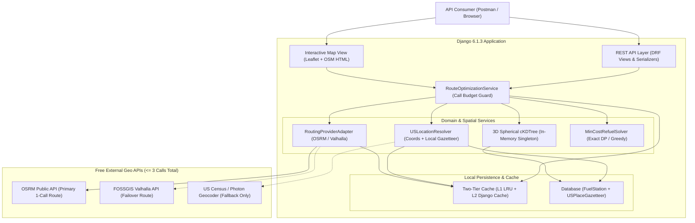

# 01 — System Architecture Specification

**Traces To**: `REQ-STACK-001`, `REQ-PERF-001`, `REQ-PERF-002`, `REQ-INT-001`, `REQ-FUNC-002`

---

## 1. Architectural Overview

The **Fuel Route Optimizer** is a modular monolith built on **Django 6.1.3** and **Django REST Framework 3.18.3**. It separates HTTP transport (`api`, `map_viewer`), geographic boundary & external provider adapters (`routing`), fuel station storage & spatial indexing (`stations`), and pure deterministic mathematical optimization (`optimizer`).



---

## 2. Technology Stack & Pinned Runtime Baseline

| Layer | Package / Technology | Version | Rationale |
| :--- | :--- | :--- | :--- |
| **Language** | Python | `>= 3.12` | Native `typing`, fast `asyncio` / `concurrent.futures`, `decimal` performance. |
| **Web Framework** | `Django` | `6.1.3` | Latest stable release per `REQ-STACK-001`. |
| **REST Layer** | `djangorestframework` | `3.18.3` | Declarative request validation, content negotiation, structured error handling. |
| **OpenAPI Schema** | `drf-spectacular` | `0.30.0` | Auto-generated OpenAPI 3.1 schema and Swagger/Redoc inspection endpoints. |
| **Spatial Search** | `scipy` + `numpy` | Latest stable | Vectorized C++ `scipy.spatial.cKDTree` over 3D Earth-chord coordinates (`< 2 ms` corridor query). |
| **HTTP Client** | `httpx` | Latest stable | Persistent HTTP/1.1 & HTTP/2 connection pooling, granular connect/read timeouts. |
| **Polyline Codec** | `polyline` (or built-in `polyline6` codec) | Latest stable | Fast precision-6 OSRM/Valhalla geometry decoding without heavy JSON transfer. |
| **Database** | SQLite (default) / PostgreSQL (optional) | Built-in / `psycopg` | Zero-configuration evaluation setup out-of-the-box; production-ready via `DATABASE_URL`. |
| **Map Frontend** | Leaflet + OpenStreetMap | `1.9.x` (CDN + SRI) | Zero-API-key interactive route, corridor, and fuel stop rendering. |
| **Test & Coverage Suite** | `pytest`, `pytest-django`, `pytest-cov`, `respx`, `playwright` | Latest stable | Enforces `>= 95%` unit test coverage (`--cov-fail-under=95`), HTTP call-budget interception, `live_server` E2E, and headless Chromium map E2E. |

---

## 3. Repository & Django Module Structure

To enforce strict separation of concerns, business and algorithmic logic live in pure Python service modules independent of DRF `Request`/`Response` objects.

| Path | Responsibility |
| :--- | :--- |
| `specs/` | Authoritative Spec-Driven Development documents (`README.md`, `01`–`07`). |
| `bin/spotter-deploy` | Standalone interactive Zero-to-Production deployment bootstrap CLI wrapper. |
| `.github/workflows/` | Automated CI (`ci.yml`) and multi-target CD pipelines (`cd-aws.yml`, `cd-gcp.yml`, `cd-azure.yml`, `cd-k8s.yml`, `cd-vps.yml`, `cd-paas.yml`). |
| `deploy/` | Terraform modules (`deploy/terraform/{aws,gcp,azure}/`), Kubernetes manifests (`deploy/k8s/`), Caddy TLS config (`deploy/caddy/`), and PaaS blueprints (`fly.toml`, `render.yaml`, `railway.json`). |
| `data/raw/fuel-prices-for-be-assessment.csv` | Extracted raw OPIS truckstop CSV dataset (`8,151` rows). |
| `data/processed/fuel_stations_us.json` | Cleaned, deduplicated, offline-geocoded US truckstop dataset (`6,626` stations). |
| `data/processed/us_gazetteer.json` | Compact US Census cities, towns, and 5-digit ZIP centroids for zero-call endpoint resolution. |
| `data/geo/us_states_boundary.geojson` | Simplified US 50-state + DC polygon boundaries for domestic validation and border checks. |
| `config/` | Django project settings (`base.py`, `local.py`, `test.py`, `production.py`), root `urls.py`, `wsgi.py`, `asgi.py`. |
| `apps/stations/` | `FuelStation` model, CSV normalization & offline enrichment commands, `StationSpatialIndex` (`cKDTree` singleton). |
| `apps/routing/` | `USPlaceGazetteer` model, `USLocationResolver`, US polygon validator, `RoutingProvider` protocol, OSRM & Valhalla clients, `ExternalCallBudget` tracker. |
| `apps/optimizer/` | Polyline projection, Haversine/chord vector math, candidate dominance pruning, `MinCostRefuelSolver`, `Decimal` cost accounting. |
| `apps/api/` | `/api/v1/route/`, `/api/v1/stations/`, `/api/v1/health/` DRF views, serializers, GeoJSON builders, custom exception handler. |
| `apps/map_viewer/` | `/api/v1/route/map/` self-contained accessible HTML/Leaflet route & fuel stop visualizer. |
| `postman/` | Exported Postman Collection v2.1 + Postman Visualizer template for instant testing and Loom walkthrough. |
| `tests/unit/` | Isolated unit & LP-oracle property tests enforcing the `>= 95%` coverage gate (`--cov-fail-under=95`). |
| `tests/integration/` | DRF endpoint, serializer, cache, failover, and `ExternalCallBudget` HTTP-interception tests. |
| `tests/e2e/` | Full-stack `live_server` TCP journeys, concurrent load tests, live upstream OSRM/geocoder E2E, and Playwright browser map E2E. |
| `tests/benchmarks/` | Sub-`15 ms` coast-to-coast spatial + refueling optimization latency benchmarks. |
| `Dockerfile` & `docker-compose.yml` | One-command containerized runtime (`docker compose up`) alongside zero-config local SQLite execution (`python manage.py runserver`). |

---

## 4. End-to-End Request Execution Flow

The sequence below illustrates all three runtime paths (**Cache Hit = 0 calls**, **Gazetteer Hit = 1 call**, and **Street Address Fallback = 2–3 calls**):

```mermaid
sequenceDiagram
    autonumber
    actor Client as API Client
    participant API as RouteAPIView
    participant Svc as RouteOptimizationService
    participant Cache as TwoTierCache
    participant Res as USLocationResolver
    participant ExtGeo as ExternalGeocoder
    participant Router as OSRMRoutingClient
    participant KD as StationSpatialIndex
    participant Opt as MinCostRefuelSolver

    Client->>API: POST /api/v1/route/ (start, finish)
    API->>Svc: optimize_route(request_dto)
    Svc->>Cache: get_cached_plan(normalized_key)

    alt Full Plan Cache Hit (0 External Calls)
        Cache-->>Svc: cached_optimization_result
        Svc-->>API: result (external_api_calls = 0)
    else Cache Miss
        Svc->>Res: resolve_both(start, finish, call_budget)
        alt Coords / Local US Gazetteer / Geocode Cache Hit
            Res-->>Svc: OriginCoord, DestCoord (0 calls used)
        else Street Address Not in Local Gazetteer
            par Parallel Geocode (<= 2 Calls)
                Res->>ExtGeo: geocode_us(start)
                Res->>ExtGeo: geocode_us(finish)
            end
            ExtGeo-->>Res: OriginCoord, DestCoord
            Res-->>Svc: Validated US OriginCoord, DestCoord (1-2 calls used)
        end

        Svc->>Router: fetch_us_driving_route(OriginCoord, DestCoord, call_budget)
        Router-->>Svc: RouteGeometry (polyline6, distance_miles, duration_sec) [1 call used]

        Svc->>KD: query_corridor_stations(route_coords, radius_miles=5.0)
        KD-->>Svc: ProjectedCandidateStations (mile_marker, detour_miles, retail_price)

        Svc->>Opt: solve_optimal_refueling(distance_miles, candidates, vehicle_spec)
        Opt-->>Svc: OptimalFuelPlan (stops, gallons, exact Decimal costs)

        Svc->>Cache: store_cached_plan(normalized_key, result, ttl=3600s)
        Svc-->>API: result (external_api_calls = 1..3)
    end

    API-->>Client: 200 OK (Route Summary + Fuel Stops + Costs + GeoJSON + map_url)
```

---

## 5. Multi-Tier Caching Strategy

To maximize throughput (`REQ-PERF-001`) and minimize upstream traffic (`REQ-PERF-002`), caching operates at three distinct granularities:

| Cache Layer | Key Pattern | Backend | TTL | Purpose |
| :--- | :--- | :--- | :--- | :--- |
| **Geocode Cache** | `geo:v1:{sha256(norm_text)}` | L1 `functools.lru_cache(4096)` + L2 Django DB/File/Redis Cache | `30 days` | Street addresses resolved once never trigger a second external geocoder call. |
| **Route Geometry Cache** | `route:v1:{lat1:.4f},{lon1:.4f}:{lat2:.4f},{lon2:.4f}` | L1 LRU (`1024` entries) + L2 Django Cache | `24 hours` | Rounding endpoints to `4` decimal places (~`11 meters`) coalesces near-identical coordinate queries and allows re-running fuel optimization with different `initial_fuel_gallons` in `< 5 ms` with `0` OSRM calls. |
| **Full Optimization Cache** | `plan:v1:{route_key}:{mpg}:{range}:{init_fuel}:{data_ver}` | L1 LRU (`1024` entries) + L2 Django Cache | `1 hour` | Includes `data_ver` hash of loaded fuel prices so reloading fuel prices automatically invalidates stale plans without manual cache flushing. |

---

## 6. Latency Budget Breakdown

Target latency for an uncached coast-to-coast route (`New York, NY` to `Los Angeles, CA`, ~`2,790` miles):

| Execution Stage | Target P50 | Target P95 | Notes |
| :--- | :--- | :--- | :--- |
| **1. Request Validation & Normalization** | `0.3 ms` | `0.8 ms` | DRF serializer + coordinate/text parsing. |
| **2. US Location Resolution (Gazetteer)** | `0.4 ms` | `1.5 ms` | Local indexed lookup + US polygon bounding check (`0` network calls). |
| **3. External Route Fetch (OSRM `polyline6`)** | `110 ms` | `280 ms` | Single pooled HTTPS call (`steps=false`, `geometries=polyline6` keeps payload ~`25 KB` instead of `500 KB` raw GeoJSON). |
| **4. Polyline Decode & 1-Mile Densification** | `1.2 ms` | `2.5 ms` | Pure NumPy vectorized interpolation (~`2,800` sample points). |
| **5. 3D `cKDTree` Corridor Query & Projection** | `1.8 ms` | `4.0 ms` | C++ `query_ball_point` across `6,626` stations + vectorized segment projection. |
| **6. Minimum-Cost Refueling Solver** | `0.6 ms` | `1.5 ms` | Exact algorithm over ~`250`–`450` corridor stations. |
| **7. GeoJSON Assembly & JSON Serialization** | `1.5 ms` | `3.5 ms` | Downsampled visual `LineString` (full precision retained in `polyline6`) for fast Postman rendering. |
| **Total Internal Compute (Excl. Network)** | **`5.8 ms`** | **`13.8 ms`** | **Well inside `< 15 ms` internal CPU budget.** |
| **Total End-to-End Uncached (City-to-City)** | **`~116 ms`** | **`~295 ms`** | **1 external call total.** |
| **Total End-to-End Cached** | **`~2.5 ms`** | **`~8.0 ms`** | **0 external calls.** |

> [!TIP]
> Requesting `geometries=polyline6&overview=full&steps=false` from OSRM reduces upstream payload size by **90%+** compared to `geometries=geojson&steps=true`, cutting network transfer latency while preserving sub-meter (`1e-6` degree) coordinate accuracy for highway corridor matching.

---

## 7. Concurrency, Thread Safety, and Startup Lifecycle

1. **Read-Only Immutable Spatial Index**:
   - `StationSpatialIndex` builds a read-only NumPy coordinate array and `scipy.spatial.cKDTree` once per worker process upon first request (or warm-up hook) protected by a `threading.Lock()`.
   - Once constructed, `cKDTree.query_ball_point` is completely stateless and thread-safe across concurrent WSGI/ASGI worker threads.
2. **Connection Pooling**:
   - External HTTP adapters share a process-level `httpx.Client` configured with `HTTPTransport(retries=1)`, `limits=Limits(max_keepalive_connections=20, max_connections=50)`, and strict timeouts (`connect=2.0s`, `read=4.0s`) so TLS handshakes are reused across requests.
3. **Graceful Upstream Failover**:
   - If the primary OSRM endpoint returns `5xx`, `429`, or exceeds the `4.0s` read timeout, `RoutingProviderChain` automatically fails over to the secondary zero-key FOSSGIS Valhalla adapter within the same request (counting transparently against `ExternalCallBudget`).
