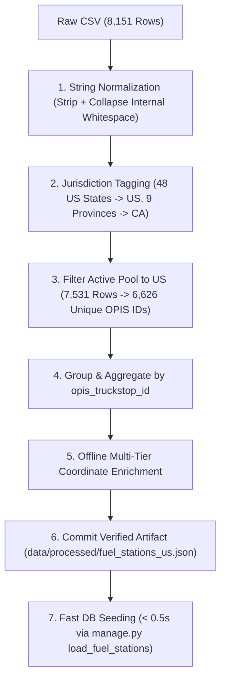
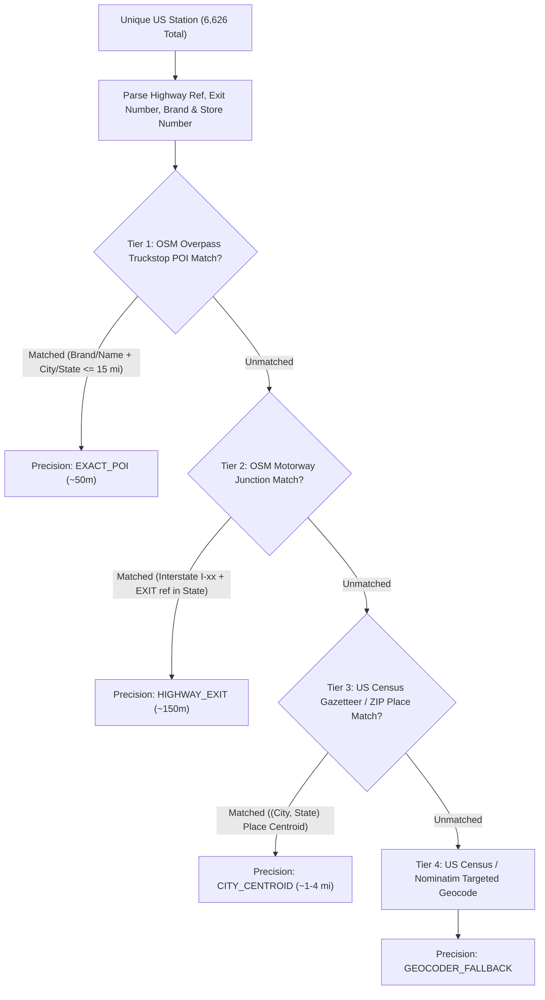
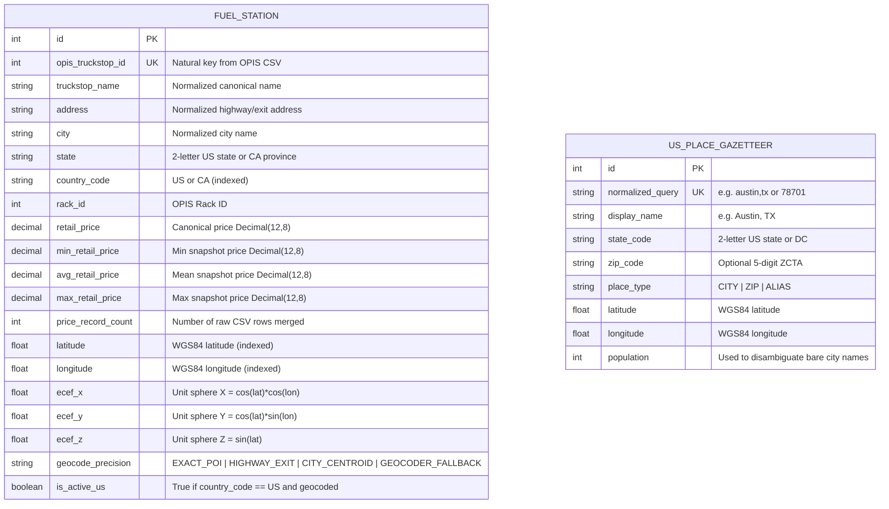

# 02 — Data Pipeline, Geocoding & Database Schema Specification

**Traces To**: `REQ-DATA-001`, `REQ-PERF-001`, `REQ-PERF-002`, `REQ-FUNC-001`

---

## 1. Forensic Audit of `fuel-prices-for-be-assessment.csv`

Before designing the schema and ingestion pipeline, the raw CSV attachment extracted from `Backend Django Engineer _ Assessment.eml` was audited across all `8,151` data rows.

### 1.1 Raw File Profile

| Attribute | Observed Value | Engineering Impact |
| :--- | :--- | :--- |
| **File Size & Encoding** | `577,081` bytes, UTF-8 | Fits comfortably in memory during ingestion. |
| **Total Lines** | `8,152` (`1` header + `8,151` data rows) | `0` blank or malformed CSV rows. |
| **Columns (7)** | `OPIS Truckstop ID`, `Truckstop Name`, `Address`, `City`, `State`, `Rack ID`, `Retail Price` | **No `Latitude` or `Longitude` columns exist in the raw CSV.** |
| **Null / Empty Cells** | `0` across all 7 columns | All fields populated; `OPIS Truckstop ID` and `Rack ID` are 100% digits. |
| **Retail Price Range** | Min `$2.68733333`, Max `$6.39900000`, Mean `$3.4990` | Up to `8` fractional digits; store raw precision as `Decimal(12, 8)`. |

### 1.2 Data Anomalies Discovered & Required Mitigations

1. **Missing Geographic Coordinates (`0%` geocoded in raw CSV)**:
   - Addresses are highway exit descriptions (`I-44, EXIT 283 & US-69`, `I-80/94, EXIT 2`, `US-46`), not street postal addresses.
   - `56.4%` (`3,738` of `6,626` US stations) reference highway `EXIT` numbers; `57.4%` (`3,805`) reference Interstate (`I-xx`) corridors.
   - Multi-station metro areas (`Phoenix, AZ`: `22` stations; `San Antonio, TX`: `19`; `Amarillo, TX`: `17`; `Indianapolis, IN`: `15`; `Dallas, TX`: `13`) span beltways 10+ miles from downtown centroids, requiring exit/POI-aware offline geocoding before falling back to city centroids.

2. **Canadian Provinces Mixed into `State` Column (`620` Non-US Rows)**:
   - Out of `57` distinct state/province codes, **`9` are Canadian provinces/territories** (`ON`: `217`, `AB`: `180`, `BC`: `121`, `MB`: `42`, `SK`: `36`, `YT`: `8`, `NS`: `6`, `QC`: `6`, `NB`: `4` = `620` rows across `112` unique OPIS IDs).
   - Remaining **`7,531` rows** span **`48` contiguous US states** (`6,626` unique US OPIS IDs across `3,808` unique `(City, State)` pairs).
   - `AK`, `HI`, and `DC` have `0` rows in the dataset (`DC` routes naturally utilize nearby `MD`/`VA` corridor stations).
   - **Rule**: Tag records with `country_code` (`US` vs `CA`); exclude `CA` stations from active US route fuel optimization per `REQ-FUNC-001` (*"both within the USA"*).

3. **Duplicate `OPIS Truckstop ID`s with Multi-Snapshot Prices (`678` Duplicate IDs)**:
   - `8,151` rows map to `6,738` unique `OPIS Truckstop ID`s (`6,626` US).
   - `678` OPIS IDs have `2` to `6+` rows; `597` of those have **different `Retail Price` values** across rows (representing multi-day OPIS price snapshots) and occasional minor string variants (e.g., `PILOT TRAVEL CENTER #1243` vs `PILOT #1243` for OPIS ID `20`).
   - Crucially, **`0` duplicate OPIS IDs conflict on `(City, State)`** — confirming `OPIS Truckstop ID` uniquely identifies a physical truckstop facility.

4. **Trailing & Internal Whitespace Pollution (`1,356` Affected Cells)**:
   - `1,256` rows contain trailing/leading spaces in `City` (e.g., `'Effingham                               '`), `97` rows in `Address` (plus double internal spaces like `'I-35,  EXIT 271'`), and `3` rows in `Truckstop Name`.

---

## 2. Deterministic Cleaning & Deduplication Specification

All raw CSV rows must pass through a pure, deterministic normalization pipeline before database persistence:

### 2.1 Field Normalization Rules
* **`opis_truckstop_id`**: Cast `int(row["OPIS Truckstop ID"].strip())`. Serves as natural unique identifier.
* **`truckstop_name` / `address` / `city`**: Strip leading/trailing whitespace and collapse consecutive whitespace (`re.sub(r"\s+", " ", val.strip())`). Normalize `city` display casing cleanly while keeping uppercase normalized key for joins.
* **`state`**: Uppercase 2-letter code (`val.strip().upper()`). Validate against `US_STATES_AND_DC` (`50` states + `DC`) vs `CA_PROVINCES`.
* **`rack_id`**: Cast `int(row["Rack ID"].strip())`.
* **`retail_price`**: Parse directly from string into `decimal.Decimal(row["Retail Price"].strip())` — never parse through IEEE-754 `float` first.

### 2.2 Deduplication & Price Aggregation Policy
When multiple CSV rows share the same `opis_truckstop_id`:
1. **Canonical Metadata**: Select the longest normalized `truckstop_name` (e.g., preferring `'PILOT TRAVEL CENTER #1243'` over `'PILOT #1243'`) and normalized `address`, `city`, `state`, `rack_id`.
2. **Canonical `retail_price` Policy**:
   - Store **all three summary metrics** on `FuelStation`:
     - `retail_price` (Primary price used by optimizer): **Minimum observed `Retail Price`** (`min_retail_price`) across duplicate snapshot rows for that `opis_truckstop_id` (or configurable `--dedup-strategy={min,avg,last}` during ingestion, defaulting to **`min`** — representing the best posted retail rate at that OPIS location, while recording `avg_retail_price`, `max_retail_price`, and `price_record_count` for full auditability).
   - Documenting and storing `min_retail_price`, `avg_retail_price`, and `last_retail_price` allows switching strategies without re-geocoding.

---

## 3. Multi-Tier Offline Geocoding Pipeline

To achieve **zero request-time geocoding calls** (`REQ-PERF-002`) while accurately locating rural highway exits and urban beltway truckstops (`REQ-DATA-001`), station coordinates are resolved **offline** through a four-tier hierarchy:

### 3.1 Tier Details
1. **Tier 1 — Bulk OpenStreetMap Truckstop POI Matching (`EXACT_POI`)**:
   - One bulk Overpass QL query downloads US `amenity=fuel` nodes/ways tagged with commercial truck brands (`Pilot`, `Flying J`, `Love's`, `TA`, `Petro`, `Kwik Trip`, `Sapp Bros`, `Speedway`, `Circle K`, `Casey's`, `Ambest`, `Road Ranger`, `Stripes`, `Cefco`) or `hgv=yes`.
   - Matches by brand + store number (`#1243`, `#796`) or fuzzy name within the target `State` and proximity of `City`.
2. **Tier 2 — Bulk OpenStreetMap Highway Exit Ramp Matching (`HIGHWAY_EXIT`)**:
   - One bulk Overpass QL query downloads US `highway=motorway_junction` nodes (`ref` exit number + parent `highway=motorway` route relation/way `ref`, e.g., `I 44` + `ref=283` in `OK`).
   - Parses `Address` regex `r"\b(I-\d+)\b.*?\bEXIT\s+(\d+[A-Z]?)\b"` and resolves directly to the exact Interstate exit ramp coordinates — critical for large cities (`Phoenix`, `San Antonio`, `Dallas`, `Indianapolis`) where beltway exits sit 10+ miles from city hall.
3. **Tier 3 — Offline US Census Bureau Gazetteer (`CITY_CENTROID`)**:
   - Matches `(normalized_city, state)` against official US Census Incorporated Places, Census Designated Places (CDPs), County Subdivisions, and GeoNames populated places entirely offline.
4. **Tier 4 — Rate-Limited Targeted Geocoder (`GEOCODER_FALLBACK`)**:
   - Any remaining unincorporated highway crossroads (~`< 2%` of stations) are queried against the free US Census Geocoder / Nominatim (`1 req/sec` with descriptive `User-Agent`), and results are persisted into `data/processed/fuel_stations_us.json`.

### 3.2 Coordinate Sanity Validation Gate
Every geocoded US station must pass automated validation before inclusion in `fuel_stations_us.json`:
* Latitude $\in [24.396308, 49.384358]$ and Longitude $\in [-124.848974, -66.885444]$ (Contiguous 48 US bounding box, matching the 48 states present in the CSV).
* Point-in-state check: Station coordinate lies within (or within a `5`-mile border tolerance of) its declared 2-letter `State` polygon in `us_states_boundary.geojson` (catching cross-state homonym errors such as `Springfield, IL` vs `Springfield, MO`).

---

## 4. Relational Database Schema (Django ORM)

### 4.1 Database Indexes
* `FuelStation`:
  - `UniqueConstraint(fields=["opis_truckstop_id"])`
  - `Index(fields=["is_active_us", "state"])`
  - `Index(fields=["is_active_us", "latitude", "longitude"])`
  - `Index(fields=["retail_price"])`
* `USPlaceGazetteer`:
  - `UniqueConstraint(fields=["normalized_query"])`
  - `Index(fields=["place_type", "-population"])`

---

## 5. In-Memory 3D Spherical `cKDTree` Spatial Index

Querying SQL `WHERE latitude BETWEEN ...` across 3,000 route points would be orders of magnitude slower and suffer from longitude cosine distortion (`1°` longitude = `69.17` miles at equator vs `45.0` miles at `49°N` in Washington/Montana). Instead, `StationSpatialIndex` uses **exact 3D spherical chord geometry**:

### 5.1 Coordinate Transformation
For Earth mean radius $R = 3958.7613\text{ miles}$ and $(\phi, \lambda) = (\text{radians}(\text{lat}), \text{radians}(\text{lon}))$:

$$X = R \cos\phi \cos\lambda, \quad Y = R \cos\phi \sin\lambda, \quad Z = R \sin\phi$$

A great-circle surface search radius $r_{\text{surface}}$ (e.g., $5.0\text{ miles}$) maps bijectively and isotropically anywhere on Earth to Euclidean 3D chord radius:

$$r_{\text{chord}} = 2 R \sin\left(\frac{r_{\text{surface}}}{2 R}\right)$$

### 5.2 Index Lifecycle & Query Execution
1. **Build Time**: Constructing `scipy.spatial.cKDTree(coords_xyz)` for `6,626` US stations takes **`~1.1 ms`** and consumes **`< 1.5 MB`** of RAM.
2. **Corridor Search**:
   - Decode the route polyline into `(N, 2)` NumPy array of `(lat, lon)` vertices.
   - Linearly interpolate any segment longer than `1.0 mile` so sample points are spaced at `<= 1.0 mile` along the entire route (`M` sample points; `M ~ 2,800` for a coast-to-coast drive).
   - Convert the `M` sample points to `(M, 3)` Cartesian `(X, Y, Z)` vectors and invoke `tree.query_ball_point(sample_xyz, r=r_chord)` in a single vectorized C call (`~1.5 ms`), taking the union of returned station indices.
3. **Cache Version Token**:
   - `StationSpatialIndex` computes a deterministic `data_version` digest over `(opis_truckstop_id, retail_price, latitude, longitude)` at build time so optimization caches automatically invalidate whenever station prices are updated.

---

## 6. Database Schema Evolution & Zero-Downtime Rollback Rules (`REQ-OPS-005`)

Because rolling back a relational database in production when it already contains large volumes of live data is error-prone and risks table locks or data loss, **every schema modification to `FuelStation`, `USPlaceGazetteer`, or any future model must be specified here first and strictly obey the Expand-Contract (Parallel Run) pattern**:

1. **Backward Compatibility with Version $N-1$**: Every database migration applied during release $N$ must remain 100% compatible with running application instances of version $N-1$. This guarantees that if a Canary, Blue-Green, or RollingUpdate deployment is rolled back (`./bin/spotter-rollback`), the previous application code continues operating without any downward database migration (`migrate` rollback).
2. **Enforced Schema Safety Rules (`python manage.py check_migration_safety`)**:
   - **`RULE-MIG-01`**: Never add a `NOT NULL` column (`AddField`) without an explicit `default` value.
   - **`RULE-MIG-02`**: Never remove a column (`RemoveField`) in the same release that removes code references; deprecate in code first, deploy, and drop in a subsequent release.
   - **`RULE-MIG-03` & `RULE-MIG-04`**: Never rename an active column (`RenameField`) or table (`RenameModel`) in place; use Expand-Contract (add new field, dual-write, backfill, switch reads, contract later).
   - **`RULE-MIG-05`**: Never execute destructive raw SQL (`DROP TABLE`, `DROP COLUMN`, `TRUNCATE`) in online migrations.
   - **`RULE-MIG-06`**: Never alter an existing nullable column to `NOT NULL` (`AlterField`) without backfilling and providing a default.
3. **Cross-Reference**: See [08-feature-flags-and-zero-downtime-database-migrations.md](./08-feature-flags-and-zero-downtime-database-migrations.md) for the full 3-phase Expand-Contract sequence and feature flag rollback architecture.

