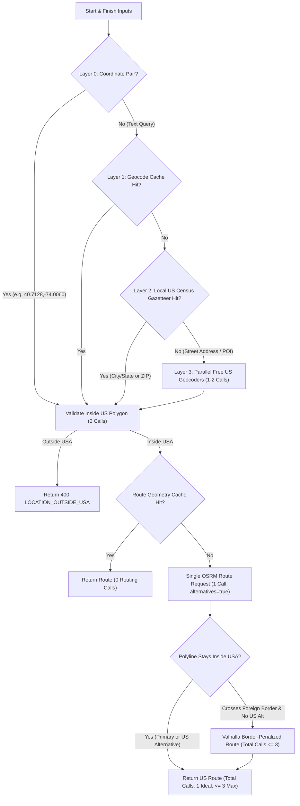
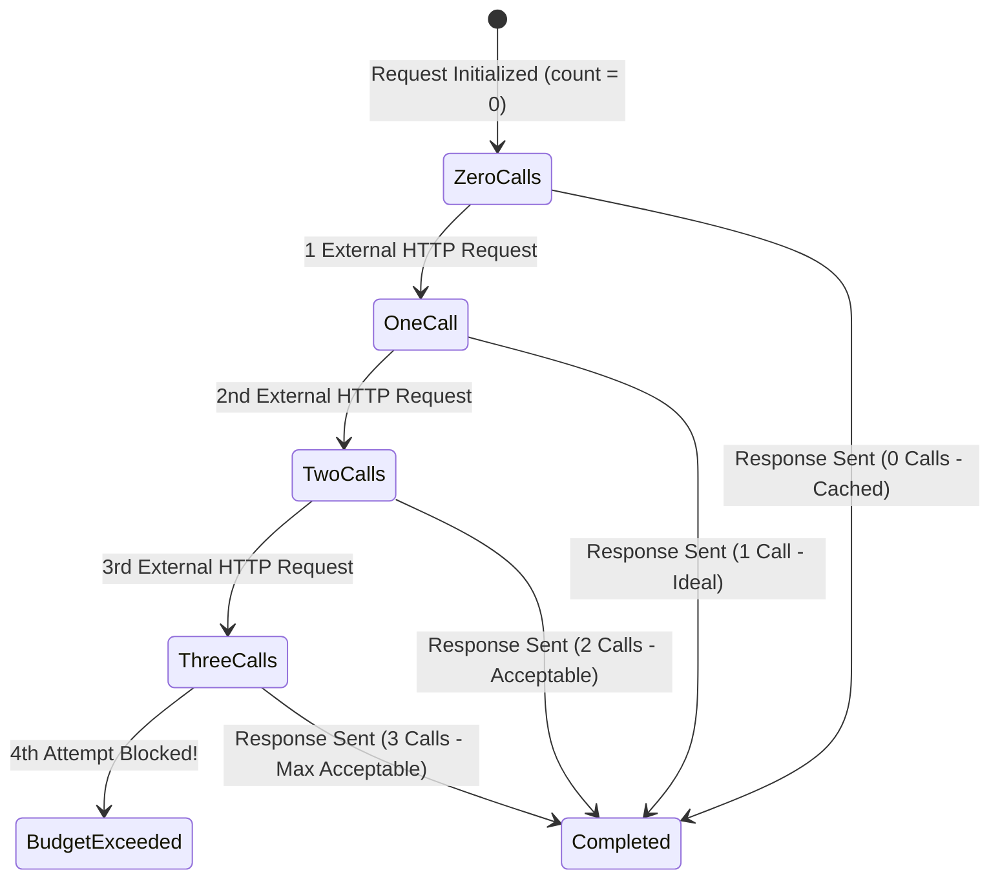

# 03 — Routing, Geocoding & US Boundary Integration Specification

**Traces To**: `REQ-FUNC-001`, `REQ-INT-001`, `REQ-PERF-001`, `REQ-PERF-002`

---

## 1. Design Goals & Call-Budget Discipline

The assessment establishes two tight operational constraints for external map and routing services:
1. **Free API Requirement**: Must use free map/routing services with zero cost barrier to evaluators cloning the repository.
2. **Call-Count Constraint**: *"One call to the map/route API is ideal, two or three is acceptable."*

To achieve **`1` external call as the standard case** and **`3` external calls as an unbreakable ceiling**, endpoint resolution and route computation are architected around a **Local-First Resolution Funnel** paired with a per-request `ExternalCallBudget` guard.



---

## 2. Accepted Location Input Formats

Both `start` and `finish` accept flexible human or machine inputs:

| Format Category | Examples | Resolution Layer | External Calls |
| :--- | :--- | :--- | :--- |
| **Coordinate Pair String** | `"40.7128, -74.0060"`, `"34.0522,-118.2437"` | Layer 0 (Regex Parser) | `0` |
| **Structured Coordinate Object** | `{"lat": 40.7128, "lng": -74.0060}` | Layer 0 (Serializer) | `0` |
| **US City + 2-Letter State** | `"New York, NY"`, `"Austin, TX"`, `"Washington, DC"` | Layer 2 (Local Gazetteer) | `0` |
| **US City + Full State Name** | `"Chicago, Illinois"`, `"Miami, Florida"` | Layer 2 (State Alias -> Gazetteer) | `0` |
| **US 5-Digit / ZIP+4 Code** | `"90210"`, `"10001"`, `"78701-1234"` | Layer 2 (Local ZCTA Gazetteer) | `0` |
| **Major Unqualified US City** | `"Seattle"`, `"Denver"`, `"Atlanta"` | Layer 2 (Population-Ranked Alias, `pop >= 100k` & unambiguous) | `0` |
| **Street Address / Landmark** | `"350 Fifth Ave, New York, NY"`, `"1600 Pennsylvania Ave NW, Washington, DC"` | Layer 3 (External Geocoder -> Cached) | `1` per uncached endpoint (`0` thereafter) |

### 2.1 Input Normalization Rules
Before lookup or caching, string inputs are normalized via:
1. Strip outer whitespace, collapse internal whitespace, remove trailing periods (`"Washington, D.C."` $\to$ `"washington, dc"`).
2. Map full US state names (`"california"` $\to$ `"ca"`, `"district of columbia"` $\to$ `"dc"`).
3. Strip `", USA"` / `", United States"` / `", US"` suffixes cleanly so `"Austin, TX, USA"` hits the local gazetteer (`"austin,tx"`).
4. Reject explicit foreign country suffixes (`", Canada"`, `", UK"`, `", Mexico"`) or Canadian province codes (`", ON"`, `", BC"`, `", QC"`, `", AB"`) immediately in `< 0.1 ms` with `400 Bad Request` (`LOCATION_OUTSIDE_USA`) without wasting external API calls.

---

## 3. USA Geographic Boundary Validation

Every resolved coordinate $(\text{lat}, \text{lon})$ — whether supplied directly by the caller or returned by a geocoder — must pass strict USA jurisdiction validation:

### 3.1 Two-Stage Spatial Check
1. **Fast Bounding-Box Pre-Filter**: Reject immediately if outside the union of Contiguous US, Alaska, and Hawaii bounding boxes (`0.01 ms`).
2. **Polygon Point-in-USA Check**: Verify point inclusion against `data/geo/us_states_boundary.geojson` (50 US states + District of Columbia, buffered by `3` miles along coastlines/Great Lakes shoreline to accommodate waterfront piers and bridges).
   - Points falling in Canada (e.g., Toronto `43.6532, -79.3832`, Windsor `42.3149, -83.0364`), Mexico (e.g., Tijuana `32.5149, -117.0382`), or international waters are rejected with `400 Bad Request` (`LOCATION_OUTSIDE_USA`).

### 3.2 Non-Contiguous & Cross-Border Edge Cases
* **Hawaii / Island Non-Connectivity**: Routes with one endpoint in Hawaii (`HI`) and another on the US mainland cannot be driven by road; return `422 Unprocessable Entity` (`NO_DRIVABLE_ROUTE`).
* **Alaska (`AK`)**: Intra-Alaska routes without OPIS station coverage or Alaska-to-Lower-48 routes (which require driving ~`1,500` miles across British Columbia and Yukon Territory outside the USA) return `422 Unprocessable Entity` (`DOMESTIC_US_ROUTE_UNAVAILABLE`) when domestic US road connectivity or `500`-mile fuel station coverage does not exist.
* **Great Lakes / Northern Border Shortcuts (e.g., `Detroit, MI` $\to$ `Buffalo, NY`)**:
  - Shortest geographic driving distance between Detroit and Buffalo crosses Ontario via Highway 401 (`~255` miles in Canada), whereas the domestic US route follows I-75 / I-80 / I-90 south of Lake Erie through Toledo, Cleveland, and Erie (`~380` miles).
  - Because `REQ-FUNC-001` specifies US routing and US OPIS fuel pricing, OSRM is queried with `alternatives=true` (still **`1` HTTP call**).
  - The route validator inspects sampled polyline vertices; if Alternative 0 exits the US polygon into Canada/Mexico while Alternative 1 stays inside the US, Alternative 1 is selected automatically.
  - If OSRM returns no purely domestic alternative, the adapter falls back to **Valhalla** with `costing_options.auto.country_crossing_penalty = 100000` (using 1 additional call within the `<= 3` budget).

---

## 4. External Geocoding Providers (Fallback Layer 3 Only)

When an input is an uncached street address or landmark that misses Layers 0–2, `USLocationResolver` invokes a resilient free geocoder chain:

| Priority | Provider | Endpoint | Auth / Key | US Filter Mechanism |
| :--- | :--- | :--- | :--- | :--- |
| **1 (Street Address)** | **US Census Bureau Geocoder** | `https://geocoding.geo.census.gov/geocoder/locations/onelineaddress` | None (Public US Gov API) | Inherently US-only (`benchmark=Public_AR_Current`). |
| **2 (POI / General)** | **Photon (Komoot OSM)** | `https://photon.komoot.io/api/` | None (Free Public API) | Bounding box bias + `properties.countrycode == "US"` post-filter. |
| **3 (Fallback)** | **Nominatim (OSM)** | `https://nominatim.openstreetmap.org/search` | None (`User-Agent` header required) | `countrycodes=us&format=jsonv2&limit=3`. |

### Parallel Execution Rule
If **both** `start` and `finish` miss the local gazetteer (e.g., two full street addresses), `USLocationResolver` dispatches both geocoding calls **concurrently** via `concurrent.futures.ThreadPoolExecutor(max_workers=2)` so wall-clock latency equals $\max(t_{\text{start}}, t_{\text{finish}})$ rather than $t_{\text{start}} + t_{\text{finish}}$, consuming `2` calls from `ExternalCallBudget`.

---

## 5. Routing Provider Adapters

All routing clients implement a clean `RoutingProvider` protocol returning a standardized `RouteResult` dataclass (`distance_miles: float`, `duration_seconds: float`, `polyline6: str`, `coordinates: list[tuple[float, float]]`, `bbox: tuple[float, float, float, float]`, `provider_name: str`).

### 5.1 Primary Provider: Project OSRM
* **Endpoint**:
  `GET https://router.project-osrm.org/route/v1/driving/{lon1},{lat1};{lon2},{lat2}?overview=full&geometries=polyline6&alternatives=true&steps=false`
* **Why `overview=full&geometries=polyline6&steps=false`**:
  - `overview=full` provides exact highway geometry (never overly simplified corners that could drift miles away from an Interstate exit).
  - `geometries=polyline6` compresses a 3,000-mile route (`~35,000` vertices) into `~25–40 KB` with `1e-6` degree (~`11 cm`) coordinate precision.
  - `steps=false` omits verbose turn-by-turn street narration text, cutting response size and JSON parsing time by an order of magnitude.
* **Unit Conversion**:
  - OSRM `distance` is in **meters**; convert via exact international mile constant:
    $$\text{distance\_miles} = \frac{\text{distance\_meters}}{1609.344}$$

### 5.2 Secondary Failover Provider: FOSSGIS Valhalla (plus Optional OpenRouteService)
* **Endpoint**: `POST https://valhalla1.openstreetmap.de/route`
* **Payload**:
  ```json
  {
    "locations": [
      {"lat": 42.3314, "lon": -83.0458},
      {"lat": 42.8864, "lon": -78.8784}
    ],
    "costing": "auto",
    "costing_options": {
      "auto": {
        "country_crossing_penalty": 100000.0,
        "country_crossing_cost": 100000.0
      }
    },
    "directions_options": {
      "units": "miles"
    }
  }
  ```
* **Optional Keyed Override**: If `ROUTING_PROVIDER=ors` and `ORS_API_KEY` are supplied via environment variables, an `OpenRouteServiceProvider` adapter (`https://api.openrouteservice.org/v2/directions/driving-car`) can also be selected without code changes.

---

## 6. Strict `ExternalCallBudget` Guard & Observability

Every incoming API request instantiates an `ExternalCallBudget(max_calls=3)`:



* Before sending any upstream HTTP request, the HTTP adapter calls `budget.acquire(service_name, operation)`.
* If `count >= 3`, `budget.acquire()` raises `ExternalCallBudgetExceededError` instead of silently issuing excessive network traffic.
* The completed call log (`count` and breakdown by service) is returned in the API response under `meta.external_api_calls` so automated tests and human reviewers can verify the `1`-call ideal / `3`-call ceiling on every request.
