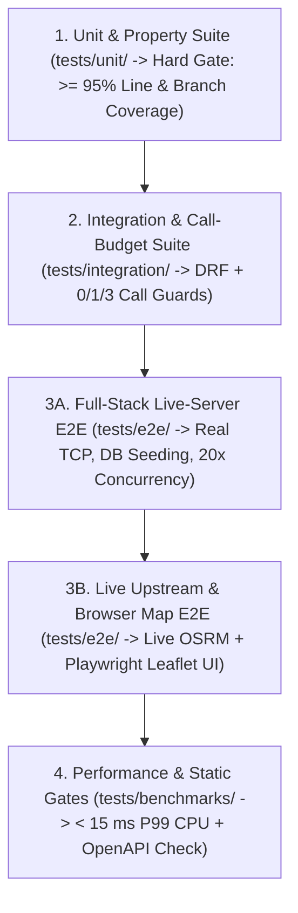
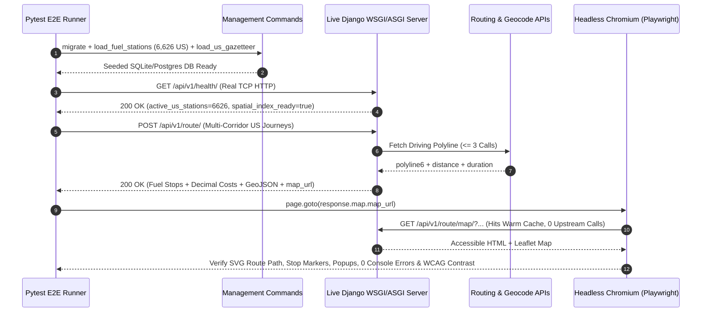
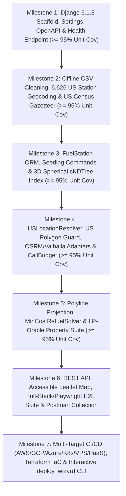

# 06 — Testing, Coverage (`>= 95%`) & End-to-End Verification Specification

**Traces To**: `REQ-FUNC-001`–`004`, `REQ-DATA-001`, `REQ-INT-001`, `REQ-STACK-001`, `REQ-PERF-001`, `REQ-PERF-002`, `REQ-DELIV-001`, `REQ-QUAL-001`, `REQ-QUAL-002`

---

## 1. Verification Architecture & Hard Quality Gates

Quality verification is structured into four distinct, non-overlapping test layers. Crucially, **unit tests (`tests/unit/`) must independently achieve at least `95%` code coverage** (`--cov-fail-under=95` with branch coverage enabled) — End-to-End tests are **never** used as a substitute to inflate unit coverage metrics.



---

## 2. Mandatory `>= 95%` Unit Test Coverage Specification (`REQ-QUAL-001`)

### 2.1 Coverage Rules & Enforcement
* **Minimum Threshold**: **`95.0%` minimum coverage** measured **exclusively** by running the isolated unit test suite:
  ```bash
  pytest tests/unit --cov=apps --cov-branch --cov-report=term-missing --cov-fail-under=95
  ```
* **Branch Coverage Required**: `branch = true` must be enabled in `[tool.coverage.run]` so partial `if`/`else` paths, boundary conditions, and exception handlers are explicitly exercised.
* **Per-Package Discipline**: Every application module (`apps/stations`, `apps/routing`, `apps/optimizer`, `apps/api`, `apps/map_viewer`) must maintain **`>= 95%`** unit coverage individually so high coverage in one module cannot mask untested logic in another.
* **Permitted Coverage Exclusions (Strictly Minimal)**:
  - Django auto-generated migration files (`apps/*/migrations/*.py`)
  - Standard WSGI/ASGI entrypoints (`config/wsgi.py`, `config/asgi.py`, `manage.py`)
  - Static `if TYPE_CHECKING:` blocks

### 2.2 Reference `pyproject.toml` Coverage Configuration
```toml
[tool.coverage.run]
source = ["apps"]
branch = true
omit = [
    "apps/*/migrations/*",
    "apps/*/tests/*",
]

[tool.coverage.report]
fail_under = 95.0
show_missing = true
skip_covered = false
exclude_lines = [
    "pragma: no cover",
    "if TYPE_CHECKING:",
    "raise NotImplementedError",
]
```

---

## 3. Unit & Integration Test Matrices

### 3.1 Data Pipeline & Spatial Index Unit Tests (`tests/unit/test_stations.py`)

| Test Case ID | Scenario | Expected Assertion |
| :--- | :--- | :--- |
| `TC-DATA-01` | Whitespace & formatting cleanup (`'Effingham                               '`, `'I-35,  EXIT 271'`) | Leading/trailing whitespace stripped; internal multi-space runs collapsed to single space. |
| `TC-DATA-02` | Jurisdiction split across `8,151` raw CSV rows | `7,531` US rows (`6,626` unique OPIS IDs) marked `is_active_us=True`; `620` Canadian rows (`AB`, `ON`, `BC`, `MB`, `SK`, `YT`, `NS`, `QC`, `NB`) marked `country_code="CA"`, `is_active_us=False`. |
| `TC-DATA-03` | Duplicate `OPIS Truckstop ID` aggregation (`--dedup-strategy` `min`, `avg`, `last`) | Single `FuelStation` record per OPIS ID; `min_retail_price`, `avg_retail_price`, `max_retail_price`, `price_record_count` exact in `Decimal`; longest canonical name selected. |
| `TC-DATA-04` | Coordinate bounding & state-polygon integrity | 100% of active US stations have valid `(lat, lon)` inside Contiguous US bounds matching declared `state`. |
| `TC-DATA-05` | 3D spherical `cKDTree` equivalence & cache invalidation | `StationSpatialIndex` radius results match brute-force Haversine scan across all `6,626` stations with `0` false negatives at `25°N` and `48°N`; `data_version` hash updates when any station price changes. |

---

### 3.2 Minimum-Cost Refueling Algorithm Unit & Property Tests (`tests/unit/test_optimizer.py`)

| Test Case ID | Scenario | Expected Assertion |
| :--- | :--- | :--- |
| `TC-OPT-01` | Zero-distance route ($D = 0.0\text{ mi}$) & short route ($D = 270.0\text{ mi}$, $f_0 = 50.0\text{ gal}$) | `fuel_stops == []`, `en_route_pump_cost_usd == Decimal("0.00")`, `ending_fuel_gallons == 23.0` (on `270` mi), `recommended_cheapest_station` populated. |
| `TC-OPT-02` | Exact range boundary ($D = 500.0\text{ mi}$, $f_0 = 50.0\text{ gal}$) | `0` mandatory stops, `ending_fuel_gallons == 0.0`, no `InsufficientFuelStationsError`. |
| `TC-OPT-03` | Just over single-tank range ($D = 500.1\text{ mi}$, $f_0 = 50.0\text{ gal}$) | Exactly `1` stop selected at minimum-price reachable station, buying exact needed delta (`0.01` gal) to arrive with `0.0` gal. |
| `TC-OPT-04` | Early opportunistic top-off (`mile 100` @ `$2.50`, `mile 450` @ `$5.00`, $D = 650\text{ mi}$) | Tops tank back up to `50.0` gal (`+10.0` gal @ `$2.50`) at `mile 100`, then buys only `+5.0` gal @ `$5.00` at `mile 450` (total `$50.00` vs naive `$75.00`). |
| `TC-OPT-05` | Downward price staircase (`$3.90 -> $3.50 -> $2.90` within range) | Buys strictly minimum bridge fuel at higher-priced stations to reach `$2.90` station with `0.0` gal, then fills at `$2.90`. |
| `TC-OPT-06` | Randomized LP Oracle Equivalence (`100` synthetic routes, $D \in [100, 3000]$) | `MinCostRefuelSolver` matches `scipy.optimize.linprog` exact linear program minimum cost to within `1e-6` across all `100` trials while verifying $0 \le f(x) \le 50.0$ everywhere. |
| `TC-OPT-07` | Detour-adjusted same-exit pruning | Prefers exit-ramp station (`0.1` mi off-route @ `$3.000`) over distant station (`4.8` mi off-route @ `$2.999`) whose round-trip detour burns more fuel than saved. |
| `TC-OPT-08` | Sparse highway segment adaptive expansion & unbridgeable failure | `520`-mile gap at `5`-mi radius expands to `15` mi and succeeds; `> 500`-mi gap at `30`-mi radius raises `InsufficientFuelStationsError`. |

---

### 3.3 Routing, Resolver & API Integration Tests (`tests/integration/test_api_and_routing.py`)

| Test Case ID | Scenario | Expected Assertion |
| :--- | :--- | :--- |
| `TC-INT-01` | **Ideal 1-Call City/ZIP/Coord Route** (`"New York, NY"` $\to$ `"Los Angeles, CA"`) | `200 OK`; `respx` verifies **exact outbound HTTP call count == `1`** (OSRM only, `0` geocoding calls); `meta.external_api_calls.total_count == 1`. |
| `TC-INT-02` | **Cached 0-Call Repeat Query** | Second identical call returns `200 OK` with **outbound HTTP call count == `0`** and `meta.cache_hit == True`. |
| `TC-INT-03` | **Uncached Street Address Route** (`"350 Fifth Ave, New York, NY"` $\to$ `"233 S Wacker Dr, Chicago, IL"`) | `200 OK`; parallel geocoding + 1 OSRM route (`<= 3` calls total). |
| `TC-INT-04` | **Hard Call-Budget Guard** | Attempting a 4th upstream call inside a single request raises `ExternalCallBudgetExceededError`. |
| `TC-INT-05` | **Non-US Rejection** (`"Toronto, ON"`, `"Monterrey, Mexico"`, or `(43.65, -79.38)`) | `400 Bad Request` (`LOCATION_OUTSIDE_USA`) with `0` OSRM calls. |
| `TC-INT-06` | **Ocean-Separated & Non-Domestic Endpoints** (`"Honolulu, HI"` $\to$ `"San Francisco, CA"`) | `422 Unprocessable Entity` (`NO_DRIVABLE_ROUTE` / `DOMESTIC_US_ROUTE_UNAVAILABLE`). |
| `TC-INT-07` | **Cross-Border Shortcut Prevention** (`"Detroit, MI"` $\to$ `"Buffalo, NY"`) | Rejects OSRM's Ontario Hwy-401 shortcut and selects the domestic US I-90 Lake Erie corridor (or fails over cleanly to Valhalla). |
| `TC-INT-08` | **Provider Failover & Timeout Handling** | OSRM `503` fails over to Valhalla `200 OK`; dual-provider failure returns `502 UPSTREAM_ROUTING_UNAVAILABLE`; timeout returns `504 UPSTREAM_SERVICE_TIMEOUT`. |

---

## 4. Comprehensive End-to-End (E2E) Test Specification (`REQ-QUAL-002`)

End-to-End tests validate the complete assembled system across real TCP sockets, real database seeding of all `6,626` US OPIS stations, real concurrency, live upstream APIs, and real browser DOM/SVG rendering.



### 4.1 Tier A — Deterministic Full-Stack Live-Server E2E (`tests/e2e/test_fullstack_e2e.py`)

Runs automatically in every local and CI test run using `pytest-django`'s `live_server` fixture, real TCP `httpx.Client` / `httpx.AsyncClient` requests, and the complete `6,626`-station dataset:

| E2E Test ID | End-to-End User Journey | Assertions Verified End-to-End |
| :--- | :--- | :--- |
| `TC-E2E-01` | **Cold-Start Seeding $\to$ Health $\to$ Coast-to-Coast Optimization** | Runs `call_command("load_fuel_stations")` and `call_command("load_us_gazetteer")` on a clean DB $\to$ verifies `/api/v1/health/` $\to$ posts `"New York, NY"` $\to$ `"Los Angeles, CA"` over TCP $\to$ verifies every returned `opis_truckstop_id` exists in `FuelStation`, `sum(stop.cost_usd) == en_route_pump_cost_usd`, all consecutive leg gaps `<= 500.0` miles, and `total_fuel_consumed_gallons == round(distance / 10, 3)`. |
| `TC-E2E-02` | **Multi-Corridor US Geography Matrix** | Executes full-stack E2E across 6 distinct US corridors: (1) East–West `New York, NY -> Los Angeles, CA`, (2) Diagonal `Seattle, WA -> Miami, FL` (`> 3,200` mi), (3) North–South `Chicago, IL -> Laredo, TX`, (4) Short-haul `Dallas, TX -> Austin, TX` (`< 500` mi, verifying `0` mandatory stops + `recommended_cheapest_station`), (5) ZIP-to-ZIP `10001 -> 90210`, and (6) Raw coordinate-to-coordinate inputs. |
| `TC-E2E-03` | **`GET` vs `POST` Parity & Dynamic Parameter Recalculation** | Verifies `GET /api/v1/route/?start=...&finish=...` matches `POST /api/v1/route/` byte-for-byte on domain fields; then re-queries the same route with `initial_fuel_gallons=10.0` and `mpg=8.0`, confirming updated stop counts/costs while reusing the cached route geometry (`0` extra routing calls). |
| `TC-E2E-04` | **JSON-to-Map-URL Follow-Through & GeoJSON Inspection** | Calls `POST /api/v1/route/`, parses `map.map_url` from the response, issues a real HTTP `GET` to `map_url`, asserts `200 OK` HTML + valid GeoJSON `FeatureCollection` (`1` `LineString`, `1` `start` `Point`, `N` `fuel_stop` `Point`s, `1` `finish` `Point`), and verifies `/api/v1/stations/` spatial lookup around Stop #1 returns that exact truckstop. |
| `TC-E2E-05` | **Negative & Error-Contract E2E Flows** | Exercises missing fields (`400 INVALID_REQUEST_PARAMETERS`), out-of-bounds `mpg=-5` (`400`), Canadian/foreign cities (`400 LOCATION_OUTSIDE_USA`), unresolvable gibberish (`404 LOCATION_NOT_FOUND`), `Honolulu, HI -> Seattle, WA` (`422 NO_DRIVABLE_ROUTE`), and OpenAPI schema download (`GET /api/schema/` $\to$ `200 OK` valid OpenAPI 3.1 document). |
| `TC-E2E-06` | **20-Client Concurrent Request Stress E2E** | Launches `20` simultaneous `httpx.AsyncClient` requests across mixed US corridors against `live_server`, verifying `100%` `200 OK` responses, thread-safe lazy `cKDTree` initialization, isolated per-request `ExternalCallBudget` counters, and zero SQLite/cache locking errors. |

---

### 4.2 Tier B — Live Upstream Network & Headless Browser Map E2E (`tests/e2e/test_live_and_browser_e2e.py`)

Validates real-world integration against live public routing/geocoding services and renders the interactive map UI in a real browser engine (`playwright` Chromium):

| E2E Test ID | Live / Browser E2E Scenario | Assertions Verified End-to-End |
| :--- | :--- | :--- |
| `TC-E2E-07` | **Live Public OSRM 1-Call Coast-to-Coast Route** | Hits live `router.project-osrm.org` for `"New York, NY"` $\to$ `"Los Angeles, CA"` and `"Chicago, IL"` $\to$ `"Dallas, TX"`. Asserts `200 OK`, `meta.external_api_calls.total_count == 1`, realistic highway mileage (`2,700`–`2,900` mi for NYC–LA), monotonic stop mile markers, and `< 20 ms` (`total_count == 0`) on immediate cached replay. |
| `TC-E2E-08` | **Live Street-Address Geocoding + Routing** | Resolves `"1600 Pennsylvania Ave NW, Washington, DC"` $\to$ `"233 S Wacker Dr, Chicago, IL"` via live free US geocoder + OSRM. Asserts `1 <= external_api_calls.total_count <= 3`, resolved states `DC` and `IL`, and valid fuel stop sequence across PA/OH/IN. |
| `TC-E2E-09` | **Live Great-Lakes Domestic Route Enforcement** | Queries `"Detroit, MI"` $\to$ `"Buffalo, NY"` against live routing upstream and verifies 100% of route waypoints and candidate/selected stations remain inside US states (`MI`, `OH`, `PA`, `NY`) rather than cutting across Ontario, Canada. |
| `TC-E2E-10` | **Playwright Headless Chromium Interactive Map E2E** | Navigates headless Chromium to `map.map_url`; asserts `0` JS `pageerror`/`console.error` events; waits for Leaflet `.leaflet-overlay-pane svg path` (route line) and numbered SVG fuel-stop markers to mount; clicks Fuel Stop #1 marker to assert popup renders station name, price/gal, gallons, and stop cost; evaluates `getComputedStyle` on summary cards and popups to verify dark high-contrast text (`#000000` / `#111827`) on light backgrounds and zero forbidden technical jargon in visible UI text. |
| `TC-E2E-11` | **Zero-to-Production Interactive CLI Wizard E2E** | Runs `python manage.py deploy_wizard` from zero in an isolated workspace across target profiles (`docker-vps`, `aws`, `gcp`, `azure`, `k8s`, `paas`); verifies cryptographic `DJANGO_SECRET_KEY` generation, `.env.production` (`0600` mode) and Terraform/K8s manifest generation, and confirms `python manage.py check --deploy` passes with `0` errors under the generated production profile. |

---

## 5. Performance & Static Quality Gates

1. **Unit Coverage Gate**: `pytest tests/unit --cov=apps --cov-branch --cov-fail-under=95` must exit `0` (`>= 95.0%`).
2. **Full Integration & E2E Gate**: `pytest tests/integration tests/e2e` must exit `0` (`100%` pass rate).
3. **Syntax & System Check Gate**:
   - `python -m py_compile` across all Python source files.
   - `python manage.py check` (`0` issues) and `python manage.py spectacular --validate` (`0` OpenAPI schema errors).
4. **Latency Benchmark Gate (`tests/benchmarks/test_latency.py`)**:
   - Coast-to-coast (`2,790` miles, `~35,000` `polyline6` vertices, `6,626` stations) internal compute pipeline (decode + `cKDTree` query + segment projection + refueling solver + GeoJSON assembly) must execute in **`< 15.0 ms` P99**.

---

## 6. Phased SDD Implementation Roadmap

Implementation proceeds through seven sequential milestones, each gated on **`>= 95%` unit test coverage** before advancing:



---

## 7. Postman Collection & 5-Minute Loom Delivery Blueprint

To satisfy `REQ-DELIV-001` (*"Make a Loom where you use Postman or similar API platform to demonstrate the API working while also giving a quick overview of your code (5 minutes max)"*), `postman/Spotter_Fuel_Route_Optimizer.postman_collection.json` ships with pre-built assertions and a Postman **Visualize** tab template following a crisp 4.5-minute run-of-show:

| Time Window | Segment | Live Action Shown |
| :--- | :--- | :--- |
| **`0:00 – 1:15`** | **Live Coast-to-Coast API Demo in Postman** | Send `POST /api/v1/route/` (`"New York, NY"` $\to$ `"Los Angeles, CA"`). Highlight fast response time (`~150 ms` uncached, `< 10 ms` cached), `meta.external_api_calls.total_count: 1` (*"1 call ideal"*), optimal fuel stops within `500`-mile range, and exact `10` MPG `Decimal` cost breakdown. |
| **`1:15 – 2:00`** | **Interactive Route & Fuel Stop Map** | Click `map.map_url` directly from Postman (and show Postman's Visualize tab) to display the full US route polyline, numbered SVG truckstop pins, retail prices, gallons pumped, and per-stop spend. |
| **`2:00 – 2:45`** | **Edge Cases & Validation in Postman** | Run (1) Short haul `"Los Angeles, CA"` $\to$ `"Las Vegas, NV"` (`270 mi` — `0` mandatory stops + cheapest station highlighted in Primm, NV), (2) Street address query (`<= 3` calls), and (3) Non-US `"Toronto, ON"` (`400 LOCATION_OUTSIDE_USA`). |
| **`2:45 – 4:20`** | **Code Architecture Walkthrough** | Walk briefly through: (1) Offline CSV cleaning & highway-exit geocoding (`apps/stations`), (2) In-memory 3D `cKDTree` spatial index (`< 2 ms`), (3) Local US Gazetteer + OSRM single-call adapter (`apps/routing`), and (4) $O(K \log K)$ monotonic-stack minimum-cost refueling solver (`apps/optimizer`). |
| **`4:20 – 4:50`** | **`>= 95%` Unit Coverage & E2E Proof** | Show terminal output of `pytest` passing the `>= 95%` unit coverage gate (`--cov-fail-under=95`), full-stack `live_server` + Playwright browser map E2E tests, and `< 15 ms` benchmark suite. |
