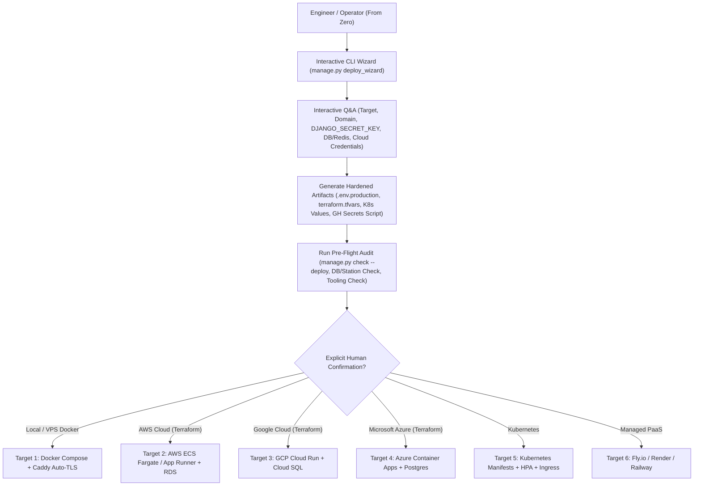
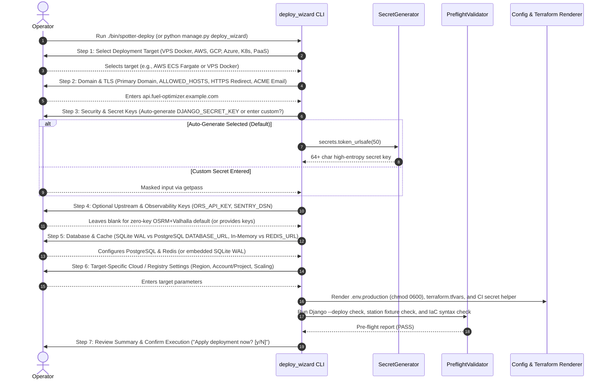
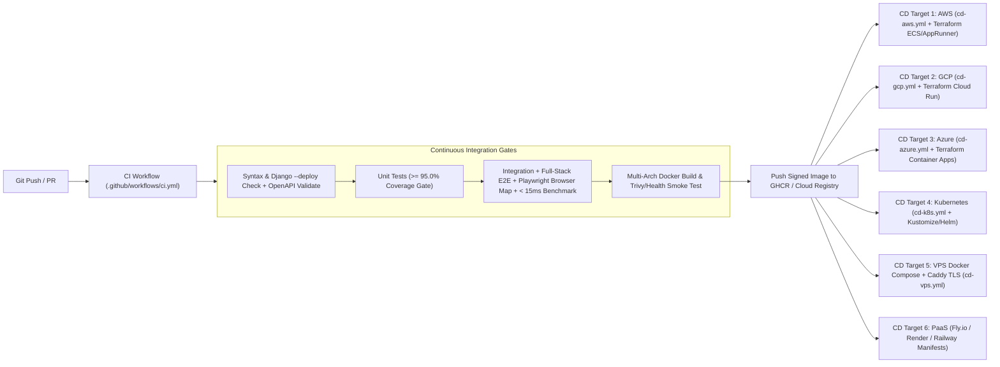
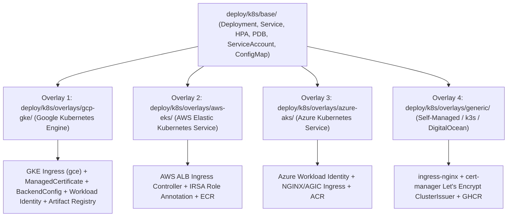
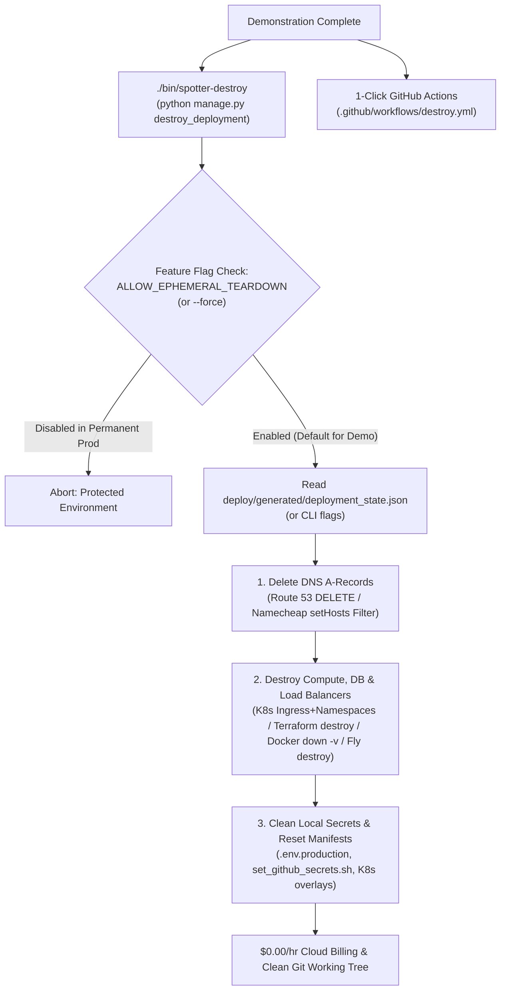

# 07 — Multi-Target CI/CD, Zero-to-Production Interactive CLI & Ephemeral Demo Teardown Specification

**Traces To**: `REQ-OPS-001`, `REQ-OPS-002`, `REQ-OPS-003`, `REQ-OPS-006`, `REQ-STACK-001`, `REQ-QUAL-001`, `REQ-QUAL-002`

---

## 1. Overview & Objectives

To support deploying the **Fuel Route Optimizer API** from a fresh clone ("from 0") into diverse enterprise and cloud environments, the project provides:
1. **An Interactive Zero-to-Production Bootstrap CLI** (`python manage.py deploy_wizard` and standalone wrapper `./bin/spotter-deploy`) that interviews the operator step-by-step for target platform, domain, secret keys, database/cache URLs, and cloud/IaC variables, validates readiness, generates hardened configurations, and orchestrates deployment.
2. **Multi-Target CI/CD Pipelines & Infrastructure-as-Code (IaC)** supporting **six production deployment targets** via GitHub Actions, Docker, Terraform, Kubernetes, and PaaS manifests.



---

## 2. Interactive Zero-to-Production Deployment CLI (`REQ-OPS-002`)

### 2.1 Entrypoints & Execution Modes
* **Django Management Command**: `python manage.py deploy_wizard [options]`
* **Standalone Bootstrap Script**: `./bin/spotter-deploy` (checks Python 3.12+ / virtual environment first, installs dependencies if needed, and invokes `deploy_wizard`).
* **Execution Modes**:
  1. **Interactive Wizard Mode (Default in TTY)**: Step-by-step guided interview with input validation, masked secret entry (`getpass`), and cryptographic key auto-generation.
  2. **Non-Interactive / Automation Mode (`--non-interactive --config <path>` or CLI flags)**: Allows CI pipelines and automated unit/E2E tests to exercise every branch of the wizard deterministically without blocking on `stdin`.
  3. **Dry-Run Mode (`--dry-run`)**: Executes all prompts, validations, and template rendering in memory and prints a redacted preview without writing files or mutating cloud state.

---

### 2.2 Step-by-Step Interactive Questionnaire Flow



### 2.3 Detailed Prompt Catalog & Validation Rules

| Step | Prompt Key | Question Presented to User | Default / Behavior | Validation Rule |
| :--- | :--- | :--- | :--- | :--- |
| **1. Target** | `deploy_target` | *"Which production environment are you deploying to?"* | `docker-vps` (`docker-vps`, `aws`, `gcp`, `azure`, `k8s`, `paas`) | Must be one of the 6 supported targets. |
| **2. Networking** | `primary_domain` | *"Domain Configuration: [1] Use cloud-generated domain (e.g. *.a.run.app on Cloud Run), [2] Enter custom public domain"* | `auto` on `gcp`, `aws`, `azure`, `paas` (`localhost` on local test) | When `auto`, sets `ALLOWED_HOSTS` to the cloud provider's wildcard suffixes (`.run.app,.a.run.app` for GCP Cloud Run, `.awsapprunner.com,.elb.amazonaws.com` for AWS, `.azurecontainerapps.io` for Azure, `.fly.dev,.onrender.com,.up.railway.app` for PaaS) and skips DNS A-record provisioning. |
| **2. Networking** | `additional_hosts` | *"Additional ALLOWED_HOSTS (comma-separated, optional):"* | `""` | Valid hostnames or CIDR/IPs. |
| **2. Networking** | `enable_https` | *"Enforce HTTPS / TLS redirect and HSTS headers?"* | `True` | Sets `SECURE_SSL_REDIRECT=True`, `SECURE_HSTS_SECONDS=31536000`, `SESSION_COOKIE_SECURE=True`, `CSRF_COOKIE_SECURE=True`. |
| **3. Secrets** | `secret_key_mode` | *"How should DJANGO_SECRET_KEY be configured? (1) Auto-generate cryptographically secure key [Recommended], (2) Enter existing key:"* | `1` (Auto-generate) | Minimum `50` characters, `>= 20` unique characters; never echoed to stdout in plaintext unless `--show-secrets` is passed. |
| **3. Secrets** | `ors_api_key` | *"Optional OpenRouteService API Key (leave blank to use free zero-key OSRM + Valhalla failover):"* | `""` | Masked input (`getpass`). |
| **3. Secrets** | `sentry_dsn` | *"Optional Sentry DSN for error monitoring (leave blank to skip):"* | `""` | If provided, validates `https://...@.../..` URL format. |
| **4. Data/Cache** | `db_mode` | *"Select database mode: [1] Provision new PostgreSQL from scratch on selected target (Cloud SQL / RDS / Azure Flexible Server / Docker Postgres), [2] Embedded SQLite WAL inside container ($0/mo DB cost), [3] Connect to existing PostgreSQL DATABASE_URL:"* | `1` (`provision`) or `2` (`sqlite`) | When `provision` (`create`) is selected, auto-generates a 32-char cryptographic `DB_PASSWORD`, writes `deploy/terraform/<target>/terraform.tfvars` (`provision_postgres = true`, `deletion_protection = false` for easy demo teardown), and configures `DATABASE_URL`. |
| **4. Data/Cache** | `redis_url` | *"Redis REDIS_URL (type 'create' to provision Managed Redis 7 from scratch on selected target [GCP Memorystore / AWS ElastiCache / Azure Cache for Redis / Docker Redis], or leave blank for local memory cache):"* | `""` or `create` (`--provision-redis`) | Validates `redis://` or `rediss://` scheme; when `create` (`--provision-redis`) is selected, writes `provision_redis = true` to `deploy/terraform/<target>/terraform.tfvars` and wires the provisioned cloud Redis endpoint into `REDIS_URL`. |
| **5. Runtime** | `gunicorn_workers` | *"Number of Gunicorn/Uvicorn worker processes:"* | `4` (`2 * CPU + 1`) | Integer `1 <= workers <= 32`. |
| **6. Cloud/IaC** | `cloud_params` | Target-specific prompts: AWS (`aws_region`, `aws_profile`, `ecr_repo`), GCP (`gcp_project_id`, `gcp_region`), Azure (`azure_subscription_id`, `azure_resource_group`, `azure_location`), K8s (`k8s_provider` $\in$ `{gcp-gke, aws-eks, azure-aks, generic}`, `cluster_name`, `namespace`, `provision_cluster_with_terraform`, `min_replicas`, `max_replicas`), or VPS (`ssh_host`, `ssh_user`, `tls_email`). | Sensible regional defaults (e.g., `us-east-1`, `us-central1`, `eastus`) | Validates format and checks local CLI availability (`terraform`, `docker`, `kubectl`, `gcloud`, `aws`, `az`) if immediate apply is requested. |

### 2.4 Generated Artifacts & Security Hygiene
1. **`.env.production`**: Written with strict `0600` (`rw-------`) file permissions and listed in `.gitignore` so secrets are never accidentally committed to Git.
2. **`deploy/generated/<target>/terraform.tfvars` or `values.prod.yaml`**: Populated with non-secret infrastructure variables; sensitive values are passed via `TF_VAR_*` environment variables or secret managers.
3. **`deploy/generated/set_github_secrets.sh`**: Optional helper script listing the exact `gh secret set` commands required for GitHub Actions CI/CD, saving the operator from manual copy-paste errors. **Never executes external secret uploads or cloud mutations without explicit typed confirmation from the human user.**

---

## 3. Production Containerization & Web Server Stack

All six deployment targets share a single hardened, multi-stage `Dockerfile`:

1. **Stage 1 (`builder`)**:
   - Base: `python:3.12-slim-bookworm`
   - Installs pinned wheels (`Django==6.1.3`, `djangorestframework==3.18.3`, `drf-spectacular==0.30.0`, `scipy`, `numpy`, `httpx`, `gunicorn`, `uvicorn`, `whitenoise`, `psycopg[binary]`).
2. **Stage 2 (`runtime`)**:
   - Runs as an unprivileged system user (`uid=10001`, `appuser`).
   - Bundles the pre-geocoded US OPIS station dataset (`data/processed/fuel_stations_us.json`) and US Census Gazetteer (`data/processed/us_gazetteer.json`).
   - Runs `python manage.py collectstatic --noinput` via WhiteNoise (`CompressedManifestStaticFilesStorage`).
   - **Container Entrypoint (`docker/entrypoint.sh`)**:
     1. Runs `python manage.py migrate --noinput`.
     2. Seeds `FuelStation` (`6,626` US stations) and `USPlaceGazetteer` if the database is empty (`< 1 second`).
     3. Warms the 3D `cKDTree` spatial index and starts `gunicorn config.wsgi:application` (or `uvicorn config.asgi:application`) with `--preload` so worker forks share the read-only spatial index via Copy-on-Write (CoW) memory!
   - **Built-in `HEALTHCHECK`**: `python -c "import urllib.request; urllib.request.urlopen('http://127.0.0.1:8000/api/v1/health/', timeout=2)"`.

---

## 4. Multi-Target CI/CD Workflows & Infrastructure-as-Code (`REQ-OPS-001`)

All cloud infrastructure resources (VPCs, security groups/firewalls, container services, managed databases, load balancers) are managed declaratively via **Terraform** (`deploy/terraform/<cloud>/main.tf`, `variables.tf`, `outputs.tf`) rather than ad-hoc imperative shell scripts.



### 4.1 Continuous Integration Workflow (`.github/workflows/ci.yml`)
Triggered on every `push` and `pull_request`:
1. **Static & Schema Gate**:
   - `python -m py_compile` on all tracked `.py` files.
   - `python manage.py check` & `python manage.py check --deploy` (with production settings profile).
   - `python manage.py spectacular --validate`.
2. **Unit Test `>= 95%` Coverage Gate**:
   - `pytest tests/unit --cov=apps --cov-branch --cov-report=xml --cov-report=term-missing --cov-fail-under=95`.
   - Fails the build immediately if unit coverage drops below `95.0%`.
3. **Full-Stack E2E, Playwright Browser Map & Benchmark Gate**:
   - Runs `pytest tests/integration tests/e2e/test_fullstack_e2e.py tests/benchmarks`.
   - Installs Playwright Chromium and runs `TC-E2E-10` headless browser verification of `/api/v1/route/map/`.
4. **Container Smoke Gate**:
   - Builds the production Docker image, starts a container, waits for `/api/v1/health/` to report `"status": "healthy"` and `"active_us_stations": 6626`, and executes an end-to-end route query against the running container.

---

### 4.2 Production Deployment Targets Matrix

| Target | IaC / Manifest Path | GitHub Actions Workflow | Architecture & Provisioned Resources |
| :--- | :--- | :--- | :--- |
| **1. VPS / Bare-Metal Docker Compose** | `docker-compose.prod.yml`, `deploy/caddy/Caddyfile` | `.github/workflows/cd-vps.yml` | App container + PostgreSQL 16 + Redis 7 + **Caddy 2** reverse proxy with automatic Let's Encrypt HTTPS/TLS provisioning and zero-downtime rolling restart. |
| **2. AWS (ECS Fargate / App Runner)** | `deploy/terraform/aws/main.tf`, `variables.tf`, `outputs.tf` | `.github/workflows/cd-aws.yml` | AWS ECR repository, VPC/Security Groups, ECS Fargate Service (or App Runner) with ALB HTTPS, RDS PostgreSQL, Secrets Manager (`DJANGO_SECRET_KEY`), and OIDC role auth. |
| **3. Google Cloud (Cloud Run)** | `deploy/terraform/gcp/main.tf`, `variables.tf`, `outputs.tf` | `.github/workflows/cd-gcp.yml` | Artifact Registry, Cloud Run v2 Service (min/max instance scaling, startup/liveness probes on `/api/v1/health/`), Cloud SQL PostgreSQL, and Secret Manager. |
| **4. Microsoft Azure (Container Apps)** | `deploy/terraform/azure/main.tf`, `variables.tf`, `outputs.tf` | `.github/workflows/cd-azure.yml` | Azure Container Registry (ACR), Log Analytics Workspace, Azure Container Apps Environment & App with HTTPS ingress, and Azure Database for PostgreSQL Flexible Server. |
| **5. Kubernetes (GCP GKE, AWS EKS, Azure AKS & Generic)** | `deploy/k8s/base/`, `deploy/k8s/overlays/{gcp-gke,aws-eks,azure-aks,generic}/`, `deploy/terraform/gcp-gke/` | `.github/workflows/cd-k8s.yml` | Kustomize base + cloud-native overlays (GKE ManagedCertificate/Workload Identity/Autopilot, EKS ALB/IRSA, AKS Workload Identity, or generic `ingress-nginx` + `cert-manager`) + optional Terraform GKE cluster provisioning from 0. |
| **6. Managed PaaS** | `fly.toml`, `render.yaml`, `railway.json` | `.github/workflows/cd-paas.yml` | Turnkey Blueprints for **Fly.io**, **Render**, and **Railway** with automatic health checks, persistent storage/Postgres attachment, and secret injection. |

---

### 4.3 Cloud-Native Kubernetes Architecture (GCP GKE, AWS EKS, Azure AKS & Self-Managed)

Kubernetes deployments use **Kustomize** (`kubectl apply -k deploy/k8s/overlays/<provider>`) so the core workload definition lives once in `deploy/k8s/base/` while cloud-specific ingress controllers, managed TLS certificates, IAM workload identities, and container registries are layered cleanly via provider overlays:



| Kubernetes Flavor | Overlay Path | Cloud Integrations & Provisioning from Zero |
| :--- | :--- | :--- |
| **Google Cloud GKE (Standard & Autopilot)** | `deploy/k8s/overlays/gcp-gke/` + `deploy/terraform/gcp-gke/` | • **From-Zero Cluster IaC**: `deploy/terraform/gcp-gke/` provisions a GKE Autopilot/Standard cluster, Artifact Registry, Cloud SQL PostgreSQL, and VPC-native networking.<br>• **GKE Workload Identity**: Annotates `ServiceAccount` with `iam.gke.io/gcp-service-account` for secretless access to GCP Secret Manager & Cloud SQL.<br>• **Native GKE Ingress & TLS**: Includes `networking.gke.io/v1` `ManagedCertificate` and `cloud.google.com/v1` `BackendConfig` wired to `/api/v1/health/`.<br>• **CI/CD Auth**: `.github/workflows/cd-k8s.yml` supports `google-github-actions/auth` + `google-github-actions/get-gke-credentials`. |
| **AWS EKS** | `deploy/k8s/overlays/aws-eks/` | • **IAM Roles for Service Accounts (IRSA)**: Annotates `ServiceAccount` with `eks.amazonaws.com/role-arn`.<br>• **AWS Load Balancer Controller**: Configures `kubernetes.io/ingress.class: alb`, ACM certificate ARN, and `/api/v1/health/` target group health check.<br>• **CI/CD Auth**: `aws-actions/configure-aws-credentials` + `aws eks update-kubeconfig`. |
| **Azure AKS** | `deploy/k8s/overlays/azure-aks/` | • **Azure Workload Identity**: Annotates `ServiceAccount` with `azure.workload.identity/client-id` and pod label `azure.workload.identity/use: "true"`.<br>• **CI/CD Auth**: `azure/login` + `azure/aks-set-context`. |
| **Generic / Self-Managed K8s** | `deploy/k8s/overlays/generic/` | • Standard `ingressClassName: nginx` + `cert-manager.io/cluster-issuer: letsencrypt-prod` + `KUBECONFIG` secret in GitHub Actions. |

---

## 4.3 Automated DNS Record Provisioning (AWS Route 53 & Namecheap API)

To eliminate manual DNS record configuration and achieve true zero-touch deployments, the deploy wizard integrates automated DNS management via `apps/stations/dns/`.

```mermaid
sequenceDiagram
    autonumber
    actor Operator as DevOps / Operator
    participant Wizard as Deploy Wizard (CLI)
    participant DNSMgr as DNSManager
    participant Provider as Route53 / Namecheap API
    participant Ingress as GKE Ingress / Caddy Proxy

    Operator->>Wizard: ./bin/spotter-deploy (or --dns-provider)
    Wizard->>DNSMgr: from_config(dns_cfg)
    Wizard->>DNSMgr: detect_public_ip()
    DNSMgr-->>Wizard: Auto-detected Target IP (e.g. 203.0.113.10)
    Wizard->>DNSMgr: sync_domains([prod_domain, staging_domain], target_ip)
    
    alt AWS Route 53
        DNSMgr->>Provider: list_hosted_zones_by_name(root_domain) [if zone omitted]
        DNSMgr->>Provider: change_resource_record_sets(UPSERT A-records)
        Provider-->>DNSMgr: ChangeInfo (PENDING -> INSYNC)
    else Namecheap DNS
        DNSMgr->>Provider: namecheap.domains.dns.getHosts (Fetch existing records)
        Note over DNSMgr: Preserves existing MX, TXT, and CNAME records!
        DNSMgr->>Provider: namecheap.domains.dns.setHosts (Merged A-records)
        Provider-->>DNSMgr: Status="OK"
    end

    DNSMgr-->>Wizard: DNSRecordResult(success=True)
    Wizard->>Ingress: Pointing complete; TLS auto-provisions immediately
```

### Supported Providers & Safety Mechanisms:
1. **AWS Route 53 (`Route53DNSProvider`)**:
   - Executes atomic `UPSERT` actions on target A-records with configurable TTL (default: 300s).
   - Auto-discovers the AWS Hosted Zone ID if omitted by walking the apex root domain via `list_hosted_zones_by_name`.
   - Supports explicit IAM credentials or ambient EC2 / EKS IAM role delegation (`boto3`).

2. **Namecheap DNS (`NamecheapDNSProvider`)**:
   - Resolves Namecheap's destructive `setHosts` behavior (which clears unmentioned hosts) by executing a read-modify-write cycle: first fetches all existing records via `getHosts`, preserves all MX, TXT, and non-conflicting records, merges updated/new A-records, and commits via `setHosts`.
   - Supports both Namecheap Production (`api.namecheap.com`) and Sandbox (`api.sandbox.namecheap.com`) endpoints.
   - Whitelisted `ClientIp` validation with auto-detection via `api.ipify.org`.

3. **CLI Arguments & Non-Interactive Flags**:
   - `--dns-provider`: `none` (default), `route53`, or `namecheap`.
   - `--dns-target-ip`: External Load Balancer or VPS public IPv4 address (auto-detected if omitted).
   - `--route53-zone-id`: AWS Route 53 Hosted Zone ID (optional; auto-discovered if blank).
   - `--namecheap-api-user`: Namecheap API user.
   - `--namecheap-api-key`: Namecheap API key / token.
   - `--namecheap-client-ip`: Namecheap whitelisted caller IP.
   - `--namecheap-sandbox`: Flag to target Namecheap sandbox environment.

---

## 5. One-Command Ephemeral Demo Teardown & Cost-Saving Destruction (`REQ-OPS-006`)

Because the initial production deployment is designed for live evaluation and demonstration, operators must be able to **destroy every provisioned cloud resource, load balancer, container, volume, and DNS record with a single command** immediately after the demo so ongoing cloud costs drop to **`$0.00/hr`** (and dangling DNS records cannot be hijacked via subdomain takeover).



### 5.1 Automatic State Tracking (`deploy/generated/deployment_state.json`)
When `python manage.py deploy_wizard` (`./bin/spotter-deploy`) provisions an environment, it writes a non-secret state manifest to `deploy/generated/deployment_state.json` containing:
- `target` (`docker-vps`, `aws`, `gcp`, `azure`, `k8s`, `paas`)
- `k8s_provider` (`gcp-gke`, `aws-eks`, `azure-aks`, `generic`)
- `domain` and `staging_domain`
- `dns_provider` (`none`, `route53`, `namecheap`), `dns_target_ip`, `route53_zone_id`, `namecheap_api_user`, `namecheap_client_ip`, `namecheap_sandbox`
- `cloud_region`

### 5.2 Automated DNS Record Deletion (`delete_a_record` & `delete_domains`)
- **AWS Route 53 (`Route53DNSProvider.delete_a_record`)**:
  - Queries `list_resource_record_sets` in the Hosted Zone to locate the exact `A` record (`TTL` and `ResourceRecords`) if `target_ip` is not explicitly supplied.
  - Submits an atomic `DELETE` batch via `change_resource_record_sets`.
  - If the record is already absent, returns `DNSRecordResult(success=True)` idempotently.
- **Namecheap (`NamecheapDNSProvider.delete_a_record`)**:
  - Fetches all existing records via `namecheap.domains.dns.getHosts`.
  - Removes only the matching `A` record (`HostName == subdomain` and `RecordType == "A"`), preserving all `MX`, `TXT`, `CNAME`, and unrelated host records, and commits via `namecheap.domains.dns.setHosts`.

### 5.3 Multi-Target Teardown Actions (`./bin/spotter-destroy`)

| Target | Teardown Commands Executed by `destroy_deployment` | Cost Impact |
| :--- | :--- | :--- |
| **`docker-vps`** | `docker compose -f docker-compose.prod.yml down --volumes --rmi local --remove-orphans` | Frees 100% of container RAM, CPU, and disk volumes. |
| **`k8s`** | `kubectl delete -k deploy/k8s/overlays/<provider> --ignore-not-found=true` + `kubectl delete namespace production staging --ignore-not-found=true` + optional `--destroy-cluster` (`gcloud container clusters delete` / `eksctl delete cluster` / `az aks delete`) | Releases billed Cloud Load Balancers, Static IPs, PersistentVolumeClaims, and (with `--destroy-cluster`) GKE/EKS/AKS clusters. |
| **`aws` / `gcp` / `azure`** | `terraform -chdir=deploy/terraform/<target> destroy -auto-approve` | Destroys Cloud Run / ECS / Container Apps, Cloud SQL / RDS, and VPC NAT/Load Balancers (`$0.00/hr`). |
| **`paas`** | `flyctl apps destroy fuel-route-optimizer --yes` | Terminates Fly.io / PaaS machines and volumes. |
| **Local Artifacts** | Deletes `.env.production`, `deploy/generated/set_github_secrets.sh`, `deploy/generated/deployment_state.json`, and restores `deploy/k8s/overlays/gcp-gke*/{certificate,ingress_patch}.yaml` to default templates. | Leaves repository clean with zero lingering secrets. |

### 5.4 Feature Flag Protection Against Accidental Production Teardown
- Controlled by `ALLOW_EPHEMERAL_TEARDOWN` in `config/settings/base.py` (`FEATURE_FLAGS["ALLOW_EPHEMERAL_TEARDOWN"] = True` by default during demonstration phase).
- Once a team transitions from ephemeral demo deployments to a long-lived production environment with customer data, running `./bin/spotter-feature-flag --set ALLOW_EPHEMERAL_TEARDOWN off` immediately locks out `destroy_deployment` unless `--force` is explicitly provided.

---

## 6. Testing Requirements for the Deployment & Teardown CLI (`>= 95%` Coverage)

In accordance with `REQ-QUAL-001` (`>= 95%` unit test coverage) and `REQ-QUAL-002` (E2E testing):
1. **Unit Tests (`tests/unit/test_deploy_wizard.py` and `tests/unit/test_dns_providers.py` — `>= 95%` coverage)**:
   - Tests interactive prompt validation (domain validation, secret entropy validation, PostgreSQL/Redis URL validation, worker count bounds) using simulated `io.StringIO` streams and `--non-interactive` flags.
   - Verifies `.env.production` generation (`0600` permissions), cryptographic `DJANGO_SECRET_KEY` auto-generation, `terraform.tfvars` rendering across all cloud targets (`aws`, `gcp`, `azure`, `k8s`, `docker-vps`, `paas`), and `--dry-run` safety (zero filesystem writes in dry-run mode).
   - Verifies AWS Route 53 UPSERT, Hosted Zone auto-discovery, and error recovery (`tests/unit/test_dns_providers.py`).
   - Verifies Namecheap XML `getHosts` record preservation, `setHosts` payload formatting, and authentication error handling.
   - Verifies public IP auto-detection and multi-domain batch synchronization across production and staging hostnames.
2. **End-to-End Tests (`tests/e2e/test_deploy_wizard_e2e.py`)**:
   - **`TC-E2E-11` (Zero-to-Production Wizard Full Lifecycle E2E)**: Invokes `python manage.py deploy_wizard` in an isolated temporary workspace from zero, generates `.env.production` and target deployment configs, boots the application with the generated production configuration (`config.settings.production`), and verifies `python manage.py check --deploy` passes with `0` errors and `/api/v1/health/` + `/api/v1/route/` respond accurately.
