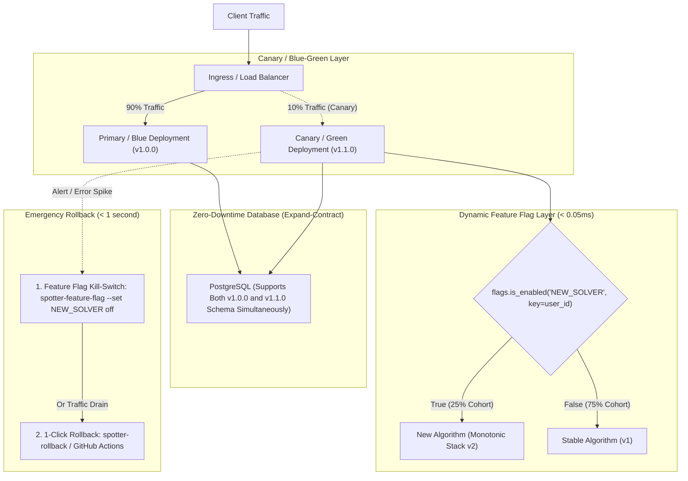

# Spec 08 — Feature Flags, Zero-Downtime Database Migrations & Safe Rollback

> **Status**: Approved & Implemented  
> **Target Version**: 1.0.0+  
> **Authors**: Spotter Engineering  

---

## 1. Executive Summary & Goals

In mission-critical production environments handling real-time routing and spatial optimization:
1. **Code Deployments Must Be Decoupled from Feature Releases**: New features must be dark-launchable, testable in production via internal overrides, and progressively rolled out via percentage gates without redeploying containers.
2. **Database Rollbacks with Live Data are Dangerous**: Rolling back application code is fast (seconds), but rolling back database schema migrations on large live databases risks table locks, schema corruption, data loss, and downtime. Therefore, **all database migrations must be 100% backward-compatible (Expand-Contract pattern)** so that previous code versions ($N-1$) continue operating without errors.
3. **Rollbacks Must Be Fast and Deterministic**: Operators must be able to roll back unhealthy releases in $< 1\text{ second}$ using Blue-Green pointer flips, Canary traffic drains, or 1-Click GitHub Actions / CLI rollbacks (`bin/spotter-rollback`).

---

## 2. Architecture & System Flow

### 2.1 Progressive Feature Flag & Canary Rollout Flow



---

## 3. Dynamic Feature Flag Subsystem

The feature flag engine is implemented in [`apps/common/flags.py`](file:///home/aldian/Documents/private/projects/spotter/fuel-route-optimizer/apps/common/flags.py):

### 3.1 Architectural Principles:
1. **Sub-Millisecond Evaluation ($< 0.05\text{ ms}$)**:
   - Uses an in-memory, thread-safe local cache with a 5-second TTL.
   - Evaluates repeatedly in high-throughput routing loops without incurring network latency to Redis.
2. **Backing Store Hierarchy**:
   - Local Memory Cache $\to$ Redis Cache (`caches["default"]`) $\to$ Django Settings (`settings.FEATURE_FLAGS`) $\to$ Default Value.
3. **Deterministic Consistent Hashing for Percentage Rollouts**:
   - Ensures an individual user, vehicle, or session key deterministically receives the same experience throughout their journey:
     $$\text{bucket} = \left(\text{SHA256}(\text{FLAG\_NAME} \mathbin{\Vert} \text{key})[:8] \pmod{10000}\right) / 100.0$$
   - If $\text{bucket} < \text{percentage}$, the flag evaluates to `True`.
4. **Testing & QA Overrides**:
   - Operators and automated integration tests can override flags on a per-request basis via the `X-Feature-Flag: NEW_FEATURE=true` HTTP header or query parameter `?_flag_NEW_FEATURE=1`.

### 3.2 CLI Management (`bin/spotter-feature-flag`)

```bash
# List all configured flags
./bin/spotter-feature-flag --list

# Enable instant kill-switch or feature toggle
./bin/spotter-feature-flag --set EXPERIMENTAL_SOLVER on
./bin/spotter-feature-flag --set EXPERIMENTAL_SOLVER off

# Progressive percentage rollout (e.g. 25% of users)
./bin/spotter-feature-flag --set CANARY_ROUTING 25%

# Revert to settings default
./bin/spotter-feature-flag --delete CANARY_ROUTING

# Lock out ephemeral teardown once moving from demo mode to permanent production
./bin/spotter-feature-flag --set ALLOW_EPHEMERAL_TEARDOWN off
```

### 3.3 Built-In Feature Flag Catalog (`settings.FEATURE_FLAGS`)

| Flag Name | Default | Purpose & Rollback / Safety Role |
| :--- | :--- | :--- |
| `CANARY_ROUTING` | `False` | Gates experimental routing provider heuristics; can be rolled out progressively (`10%`, `25%`, `100%`) or killed in `< 0.1 s`. |
| `EXPERIMENTAL_SOLVER` | `False` | Gates experimental solver extensions while preserving the stable $O(K \log K)$ monotonic queue solver as fallback. |
| `ALLOW_EPHEMERAL_TEARDOWN` | `True` | Permits one-command demo environment destruction (`./bin/spotter-destroy` / `python manage.py destroy_deployment`). Set to `off` once transitioning from demo mode to permanent production to prevent accidental infrastructure destruction. |

---

## 4. Zero-Downtime Database Migration Policy (Expand-Contract)

Because rolling back database migrations with live production data is risky and prone to locking tables, all schema changes must follow the **Expand and Contract (Parallel Run)** lifecycle across 3 distinct releases:

```mermaid
sequenceDiagram
    autonumber
    participant AppOld as App Version N-1
    participant DB as PostgreSQL
    participant AppNew as App Version N (Deploying)

    Note over DB: Phase 1: Expand
    Note over DB: Add new nullable column or column with default.
    AppOld->>DB: Reads old column, writes to old column (Still Works!)
    AppNew->>DB: Reads old/new column, dual-writes to both columns

    Note over DB: Phase 2: Parallel Run & Backfill
    Note over DB: Background worker backfills historical data from old to new column.
    
    Note over DB: Phase 3: Contract (Subsequent Release)
    Note over AppNew: Deploy Version N+1 (exclusively uses new column).
    Note over DB: Safe to drop old column; N-1 is no longer running anywhere!
```

### 4.1 Strict Migration Safety Rules Enforced by CI Linter

The migration linter command [`apps/common/management/commands/check_migration_safety.py`](file:///home/aldian/Documents/private/projects/spotter/fuel-route-optimizer/apps/common/management/commands/check_migration_safety.py) automatically inspects all Django migrations and fails the CI build if any of the following rules are violated:

| Rule ID | Operation | Hazard | Required Safe Pattern |
| :--- | :--- | :--- | :--- |
| **`RULE-MIG-01`** | `AddField` with `null=False` & no `default` | Table lock on PostgreSQL; instances of version $N-1$ will execute `INSERT` statements without the new column, triggering fatal `NOT NULL` constraint violations. | Add column as `null=True`, or supply an explicit default value (`default=...`). |
| **`RULE-MIG-02`** | `RemoveField` | Instant failure of version $N-1$ pods selecting or updating the removed field during rolling update. | Follow Expand-Contract: (1) Deprecate field in code and remove references, (2) Deploy, (3) Drop column in subsequent release. |
| **`RULE-MIG-03`** | `RenameField` | Instantly breaks running SQL queries from $N-1$ pods. | Add new field, dual-write in code, backfill data, and drop old field later. |
| **`RULE-MIG-04`** | `RenameModel` | Renames the underlying table, breaking all queries from $N-1$ pods. | Create new table, migrate data, and switch reads. |
| **`RULE-MIG-05`** | `RunSQL` with `DROP TABLE`, `DROP COLUMN`, `TRUNCATE` | Destructive DDL commands lock tables and destroy data. | Prohibited during online production deployments. |
| **`RULE-MIG-06`** | `AlterField` from nullable to `null=False` without default | Will fail on existing NULL rows and locks the table. | Backfill all existing rows first, then add constraint. |

### 4.2 Running the Migration Linter

```bash
# Run locally or in pre-commit hook
./bin/spotter-check-migrations

# CI execution (fails build on unsafe operations)
python manage.py check_migration_safety --fail-on-warning
```

---

## 5. Safe Rollback Mechanisms

We provide 4 complementary rollback layers depending on the severity and platform:

### 5.1 Layer 1: Feature Flag Kill-Switch ($< 0.1\text{ s}$, Zero Container Action)
- If an issue is isolated to a new feature, toggle the flag off:
  ```bash
  ./bin/spotter-feature-flag --set FAULTY_FEATURE off
  ```
- **Result**: Feature is instantly disabled across all pods without redeploying code, restarting pods, or invalidating database state.

### 5.2 Layer 2: Blue-Green Instant Traffic Switch ($< 1\text{ s}$)
- In [`deploy/k8s/overlays/blue-green/`](file:///home/aldian/Documents/private/projects/spotter/fuel-route-optimizer/deploy/k8s/overlays/blue-green/):
  - Two parallel deployments are maintained: `fuel-route-optimizer-blue` and `fuel-route-optimizer-green`.
  - The Kubernetes Service selector points to the active color.
  - To roll back instantly from Green to Blue:
    ```bash
    ./deploy/k8s/overlays/blue-green/switch_traffic.sh blue production
    ```
  - **Result**: 100% of live traffic reverts to Blue in $< 1\text{ second}$.

### 5.3 Layer 3: 1-Click Rollback in GitHub Actions (`.github/workflows/rollback.yml`)
- Operators can trigger an emergency rollback directly from GitHub Actions UI:
  1. Open GitHub Actions $\to$ Select **"Rollback Deployment (1-Click Emergency Rollback)"**.
  2. Choose `target_env`: `production` or `staging`.
  3. Enter audit reason (e.g. "Latency spike on coast-to-coast solver").
  4. Click **"Run workflow"**.
- **Result**: GitHub Actions runs `kubectl rollout undo`, monitors `rollout status`, probes `/api/v1/health/`, and writes an immutable audit record to the workflow summary.

### 5.4 Layer 4: CLI Rollback (`bin/spotter-rollback`)
- For operators connected via terminal:
  ```bash
  # Revert to previous healthy revision
  ./bin/spotter-rollback --target k8s --namespace production

  # Revert to a specific revision with automated health check verification
  ./bin/spotter-rollback --target k8s --namespace production --to-revision 3 --verify-url https://api.fuel-optimizer.com/api/v1/health/

  # Revert Docker Compose VPS deployment
  ./bin/spotter-rollback --target docker
  ```
