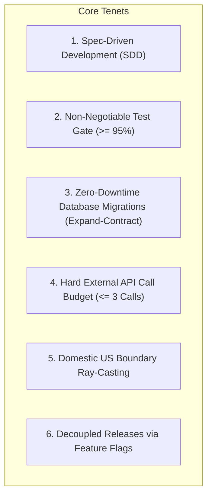
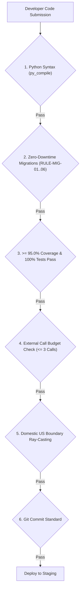

# Spec 09 — Developer Rules of Engagement & System Integrity

> **Status**: Approved & Active  
> **Audience**: All engineers and contributors  
> **Reference**: [CONTRIBUTING.md](../CONTRIBUTING.md)  

---

## 1. Purpose & Core Tenets

To ensure the long-term reliability, low-latency performance ($< 15\text{ ms}$), and zero-downtime availability of the **Spotter Fuel Route Optimizer**, all contributors must strictly adhere to this standard. System integrity is not an afterthought; it is actively validated on every commit and PR.

---

## 2. The 6 Non-Negotiable Automated Gates

Every branch and pull request targeting `main` must pass all 6 automated quality gates:

### 2.1 Gate 1: Python Compilation & Typing
- **Rule**: Run `python -m py_compile <file>` after significant changes.
- **Typing**: All functions, methods, and serializers must declare complete type annotations.
- **CI Step**: Automated `py_compile` checks all files in `manage.py`, `config/`, and `apps/`.

### 2.2 Gate 2: Database Schema Safety (Expand-Contract)
- **Problem**: In online production databases, direct column deletions or additions with `NOT NULL` lock tables and break $N-1$ instances during rolling updates.
- **Enforced Rules**:
  - `RULE-MIG-01`: No `AddField` with `null=False` and no default.
  - `RULE-MIG-02`: No `RemoveField` in active releases.
  - `RULE-MIG-03`: No `RenameField`.
  - `RULE-MIG-04`: No `RenameModel`.
  - `RULE-MIG-05`: No raw SQL with `DROP TABLE`, `DROP COLUMN`, `TRUNCATE`.
  - `RULE-MIG-06`: No altering nullable to `null=False` without defaults.
- **Verification Tool**: `./bin/spotter-check-migrations`.

### 2.3 Gate 3: Test Suite Quality & $\ge 95\%$ Coverage
- **Threshold**: Line and branch coverage must meet or exceed **$95.0\%$** across `apps/`.
- **Pass Rate**: Must be **$100\%$**; no skipped or failing tests allowed.
- **Isolation**: Unit tests must not make external network requests; all geocoders, routing APIs, and DNS providers must be mocked.
- **Command**: `pytest tests/ --cov=apps --cov-fail-under=95`.

### 2.4 Gate 4: External API Call Budget ($\le 3\text{ Calls}$)
- **Offline Gazetteer**: 65,920 Census places and ZIP codes must resolve offline with **0 external API calls**.
- **Hard Guard**: `ExternalCallBudget` guarantees no route optimization request exceeds 3 external calls.

### 2.5 Gate 5: Domestic US Scope & Geo-Boundary Enforcement
- **Ray-Casting Algorithm**: High-resolution ray-casting point-in-polygon validator (`apps/routing/boundary.py`) validates all route points against the US border.
- **Foreign Rejection**: Requests starting, ending, or traversing non-US territory (e.g. Ontario shortcut between Detroit and Buffalo) must be rejected with `LOCATION_OUTSIDE_USA`.

### 2.6 Gate 6: Git Commit Message Quality
- **Rule**: Commit messages must describe the **content change** (what was added, modified, or removed), never the action taken or process details.
  - ✅ `"Add Category and Title facet bar charts to browse page"`
  - ❌ `"Sync from dev server: latest browse.tt"`

---

## 3. UI, Accessibility (a11y) & UX Standards

- **Text Contrast**: Never use white or light gray text on light backgrounds. Ensure all body, summary, and informational texts are dark or black (`#000000` / `--text`) to guarantee high accessibility contrast.
- **No Technical Jargon in UI Copy**: Never expose internal software engineering jargon (such as `"payload"`, `"hydration"`, `"JWT"`, `"endpoint"`, `"UUID"`, `"deeplink"`) or cloud infrastructure vendor names to end users.
- **Branding Assets**: Use modern vector SVG icons rather than raster graphics.

---

## 4. Operational Emergency Hierarchy

If an error or degradation occurs in production:
1. **Level 1 (Feature Kill-Switch)**: `./bin/spotter-feature-flag --set FEATURE_NAME off` (< 0.1s, no restarts).
2. **Level 2 (Blue-Green Pointer Switch)**: `./deploy/k8s/overlays/blue-green/switch_traffic.sh blue production` (< 1s).
3. **Level 3 (1-Click GitHub Actions Rollback)**: Trigger `.github/workflows/rollback.yml`.
4. **Level 4 (CLI Rollback)**: `./bin/spotter-rollback --target k8s --namespace production`.
