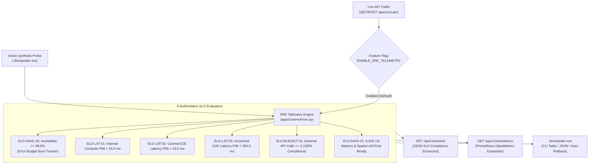

# 10 — Site Reliability Engineering (SRE), SLI/SLO Telemetry & Automated SLA Compliance Specification

**Traces To**: `REQ-OPS-007`, `REQ-PERF-001`, `REQ-PERF-002`, `REQ-DATA-001`, `REQ-OPS-004`

---

## 1. Overview & Objectives

To allow operators, evaluators, and CI/CD pipelines to verify at any moment whether the **Fuel Route Optimizer API** is meeting its Service Level Agreements (SLAs), the system includes a built-in **Site Reliability Engineering (SRE) & SLA Observability Subsystem** (`apps/common/sre.py`).

It provides:
1. **Real-Time SLI (Service Level Indicator) Telemetry**: Thread-safe, sub-microsecond ring-buffer and counter telemetry capturing internal `cKDTree` + DP compute latency, end-to-end cached/uncached latency percentiles (`P50`, `P95`, `P99`), external API call counts, cache hit ratio, and HTTP error rates.
2. **Automated SLO (Service Level Objective) & Error Budget Evaluation**: Evaluates live traffic and synthetic probes against the **6 Authoritative SLAs**, calculating remaining **Error Budget ($99.9\%$ Availability SLO)**.
3. **REST SLA Report, Interactive SRE Console, Synthetic Probe & Prometheus Metrics Endpoints**:
   - `GET /api/v1/sre/sla/`: Real-time JSON SLA compliance scorecard (aggregated across workers via shared Redis cache when configured).
   - `GET /api/v1/sre/metrics/`: Prometheus / OpenMetrics text exposition for Grafana dashboards and Alertmanager rules.
   - `GET /api/v1/sre/dashboard/`: Self-contained interactive SRE & SLO Observability Console with real-time Error Budget burn bar, P50/P95/P99 latency gauges, Redis cache hit ratio, and one-click live US corridor load/cache drill.
   - `POST /api/v1/sre/probe/`: Executes an active synthetic multi-corridor US optimization & cache drill to verify all 6 SLOs under live load.
4. **One-Command CLI SLA Auditor (`./bin/spotter-sre` / `python manage.py check_sla`)**: Runs active synthetic probes + live telemetry checks to verify all 6 SLAs from the terminal or CI/CD, with optional `--remote-url` and `--auto-rollback` integration if an SLA is breached.
5. **Cloud-Native Uptime Monitoring**: Provisions a global HTTPS Uptime Check (`google_monitoring_uptime_check_config`) on Google Cloud Monitoring when deployed to GCP Cloud Run via Terraform.



---

## 2. The 6 Authoritative SLAs / SLOs (`specs/README.md` §4)

| SLO ID | Metric / Service Level Indicator (SLI) | Target Objective (SLA) | Breach Action |
| :--- | :--- | :--- | :--- |
| **`SLO-AVAIL-01`** | Successful request ratio ($1 - \frac{\text{5xx Errors}}{\text{Total Requests}}$) | **$\ge 99.9\%$** ($0.1\%$ error budget) | Alert / Auto-Rollback when error budget exhausted |
| **`SLO-LAT-01`** | Internal `cKDTree` + DP solver compute time (`compute_time_ms`) | **$P99 < 15.0\text{ ms}$** | Fail SLA check (`status = BREACHED`) |
| **`SLO-LAT-02`** | End-to-end HTTP latency on cached route queries | **$P95 < 20.0\text{ ms}$** | Fail SLA check (`status = BREACHED`) |
| **`SLO-LAT-03`** | End-to-end HTTP latency on uncached city-to-city route queries | **$P95 < 350.0\text{ ms}$** | Fail SLA check (`status = BREACHED`) |
| **`SLO-BUDGET-01`** | Outbound routing + geocoding calls per request (`external_api_calls`) | **$\le 3\text{ calls}$** ($100\%$ compliance) | Hard `ExternalCallBudget` exception + SLA breach |
| **`SLO-DATA-01`** | Active US fuel stations (`is_active_us=True`) & 3D `cKDTree` index state | **$\ge 6,626\text{ stations}$ & `spatial_index_ready=True`** | Fail readiness & SLA check |

---

## 3. Feature Flag Control (`ENABLE_SRE_TELEMETRY`)

In accordance with [Spec 08](./08-feature-flags-and-zero-downtime-database-migrations.md):
- Controlled by `ENABLE_SRE_TELEMETRY` in `config/settings/base.py` (`True` by default).
- Can be toggled dynamically in `< 0.1 s` via `./bin/spotter-feature-flag --set ENABLE_SRE_TELEMETRY off` without restarting containers.

---

## 4. API & CLI Interfaces

### 4.1 REST Endpoints
1. **`GET /api/v1/sre/sla/`**:
   - Returns HTTP `200 OK` with:
     - `overall_status`: `"MEETING_SLA"` or `"BREACHED"`
     - `sla_compliant`: `true` / `false`
     - `error_budget`: `{ "target_availability_pct": 99.9, "observed_availability_pct": 100.0, "error_budget_remaining_pct": 100.0 }`
     - `slos`: List of all 6 SLO evaluations with `id`, `name`, `target`, `actual`, and `passed` (`true`/`false`).
     - `telemetry`: Request counts, cache hit rate, latency percentiles (`p50`, `p95`, `p99`), and external call statistics.
2. **`GET /api/v1/sre/metrics/`**:
   - Returns `text/plain; version=0.0.4` Prometheus metrics including `spotter_sla_compliant`, `spotter_requests_total`, `spotter_compute_latency_ms_p99`, `spotter_error_budget_remaining_pct`, and `spotter_active_us_stations`.

### 4.2 CLI Command (`./bin/spotter-sre` / `python manage.py check_sla`)
```bash
# Run synthetic route probes + evaluate all 6 SLAs with formatted scorecard
./bin/spotter-sre

# Emit machine-readable JSON for CI/CD pipelines or monitoring agents
./bin/spotter-sre --json

# Automatically trigger deployment rollback if any SLA is breached
./bin/spotter-sre --auto-rollback --rollback-target k8s --dry-run
```
