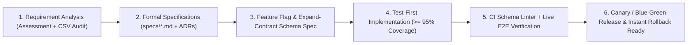

# Fuel Route Optimizer — Specification Suite (Spec-Driven Development)

This directory contains the authoritative engineering specifications for the **US Fuel Route Optimizer API**, built using **Spec-Driven Development (SDD)**. Every architectural boundary, data normalization rule, external API budget, mathematical invariant, REST payload field, and verification gate is specified here prior to implementation.

---

## 1. Specification Document Index

| Document | Scope & Contents |
| :--- | :--- |
| [README.md](./README.md) | SDD workflow, assessment requirement traceability matrix, non-functional SLAs, and Architectural Decision Records (ADRs). |
| [01-system-architecture.md](./01-system-architecture.md) | Django 6.1.3 modular architecture, request lifecycle, multi-tier caching, concurrency, and latency budgets. |
| [02-data-pipeline-and-schema.md](./02-data-pipeline-and-schema.md) | Forensic audit of `fuel-prices-for-be-assessment.csv` (`8,151` rows), deduplication rules, offline multi-tier geocoding, relational schema, and in-memory 3D `cKDTree` spatial index. |
| [03-routing-and-geocoding-integration.md](./03-routing-and-geocoding-integration.md) | USA geographic validation, zero-call local US Census Gazetteer, parallel geocoder fallback, OSRM/Valhalla routing adapters, and strict `1`-to-`3` external call enforcement. |
| [04-fuel-optimization-algorithm.md](./04-fuel-optimization-algorithm.md) | Formal mathematical formulation (`500`-mile max range, `10` MPG, `50`-gallon capacity), polyline mile-marker projection, detour modeling, exact minimum-cost refueling solver, and fuel cost accounting. |
| [05-api-contract-and-map-delivery.md](./05-api-contract-and-map-delivery.md) | REST API endpoints, request/response JSON schemas, GeoJSON `FeatureCollection`, encoded polyline, self-contained interactive map view, error catalog, and Postman integration. |
| [06-testing-verification-and-delivery-plan.md](./06-testing-verification-and-delivery-plan.md) | `>= 95%` unit test coverage gate, integration, LP-oracle property, full-stack & live-browser End-to-End (E2E) test suites, performance benchmarks, phased roadmap, and 5-minute Loom blueprint. |
| [07-cicd-and-production-deployment-cli.md](./07-cicd-and-production-deployment-cli.md) | Multi-target CI/CD pipelines (AWS, GCP, Azure, Kubernetes, VPS Docker/Caddy, PaaS), Terraform IaC, automated Route 53 & Namecheap DNS provisioning, and interactive zero-to-production `deploy_wizard` CLI. |
| [08-feature-flags-and-zero-downtime-database-migrations.md](./08-feature-flags-and-zero-downtime-database-migrations.md) | Sub-millisecond dynamic feature flags, Expand-Contract zero-downtime database migration rules (`RULE-MIG-01`..`06`), Canary/Blue-Green traffic splitting, and 1-click emergency rollbacks. |
| [09-developer-rules-and-system-integrity.md](./09-developer-rules-and-system-integrity.md) | The 6 non-negotiable automated quality gates, SDD rules of engagement, and contributor governance. |
| [10-sre-and-sla-observability.md](./10-sre-and-sla-observability.md) | Site Reliability Engineering (SRE) telemetry, real-time SLI/SLO & Error Budget evaluation, `/api/v1/sre/sla/` & Prometheus `/api/v1/sre/metrics/` endpoints, and `./bin/spotter-sre` CLI auditor. |

---

## 2. Spec-Driven Development (SDD) Workflow

All development in this repository follows a strict specification-first lifecycle. **The files in `specs/` are the authoritative single source of truth.** No production feature code or database migration is merged unless specified in `specs/` first, mapped to an explicit requirement ID (`REQ-*`), gated behind a feature flag when introducing new behavior, and verified against automated schema-safety and acceptance tests.

### SDD Governance Rules
1. **Spec Files as Single Source of Truth**: Every architectural boundary, API contract, fuel optimization formula, feature flag, and database schema change must be authored or updated in `specs/` **before** application code is written or modified. Code is strictly a downstream realization of these specifications.
2. **Feature Flags for Instant Feature Rollback**: Every new capability or experimental heuristic defined in `specs/` must specify its feature flag identifier (`apps/common/flags.py`), default value, consistent-hashing percentage rollout behavior, and fallback path. This decouples code deployment from feature release and allows operators to roll back any feature in `< 0.1 s` (`./bin/spotter-feature-flag --set <FLAG> off`) without redeploying containers.
3. **Strict Database Schema Rules (Expand-Contract) for Safe Release Rollback**: Rolling back a relational database in production once live data has been written is dangerous and risks table locks or data loss. Therefore, all schema changes specified in `specs/` must obey the **Expand-Contract (Parallel Run)** pattern (`RULE-MIG-01` through `RULE-MIG-06` in [08-feature-flags-and-zero-downtime-database-migrations.md](./08-feature-flags-and-zero-downtime-database-migrations.md)), enforced in CI by `python manage.py check_migration_safety`:
   - Never add a `NOT NULL` column without a `default`.
   - Never drop (`RemoveField`) or rename (`RenameField` / `RenameModel`) an active column or table in the same release as code changes.
   - Never run destructive raw SQL (`DROP TABLE`, `DROP COLUMN`, `TRUNCATE`).
   - Every database migration must remain **100% backward-compatible with code version $N-1$**, ensuring that Canary, Blue-Green, or `kubectl rollout undo` code rollbacks succeed immediately without rolling back the database schema.
4. **Traceability**: Every module, serializer, service, and test suite links back to `REQ-*` identifiers defined in Section 3.
5. **Deterministic Reproducibility**: Cloning the repository, installing pinned dependencies, running migrations, and loading pre-enriched station fixtures must succeed offline in under 5 seconds without requiring paid API keys.
6. **Mandatory Coverage & E2E Quality Gates**: Unit tests must maintain **at least `95%` coverage** (`--cov-fail-under=95`), and full **End-to-End (E2E) tests** (spanning cold-start seeding, real `live_server` HTTP calls, live upstream routing/geocoding verification, and interactive map rendering) must pass before any milestone is marked complete.

---

## 3. Assessment Requirements Traceability Matrix

Every explicit and implicit requirement from the assessment specification is decomposed below into testable engineering requirements.

| Req ID | Assessment Prompt Statement | Engineering Requirement Summary | Primary Spec |
| :--- | :--- | :--- | :--- |
| `REQ-FUNC-001` | *"Build an API that takes inputs of start and finish location both within the USA"* | Accept `start` and `finish` as US city/state names, ZIP codes, street addresses, or coordinate pairs; validate that both endpoints lie within the United States and reject non-US locations with `400 Bad Request`. | [03-routing-and-geocoding-integration.md](./03-routing-and-geocoding-integration.md), [05-api-contract-and-map-delivery.md](./05-api-contract-and-map-delivery.md) |
| `REQ-FUNC-002` | *"Return a map of the route along with optimal location to fuel up along the route -- optimal mostly means cost effective based on fuel prices"* | Return full route geometry (`polyline6` + GeoJSON `FeatureCollection` containing route `LineString`, start/finish pins, and ordered fuel stop `Point` features) plus a clickable `map_url` rendering an interactive browser map. | [04-fuel-optimization-algorithm.md](./04-fuel-optimization-algorithm.md), [05-api-contract-and-map-delivery.md](./05-api-contract-and-map-delivery.md) |
| `REQ-FUNC-003` | *"Assume the vehicle has a maximum range of 500 miles so multiple fuel ups might need to be displayed on the route"* | Enforce a strict `500.0`-mile maximum driving distance (`50.0`-gallon tank capacity) on initial departure, between consecutive fuel stops, and to the final destination, accounting for off-highway station detour distances. | [04-fuel-optimization-algorithm.md](./04-fuel-optimization-algorithm.md) |
| `REQ-FUNC-004` | *"Also return the total money spent on fuel assuming the vehicle achieves 10 miles per gallon"* | Compute fuel consumption at `10.0` MPG using `Decimal` arithmetic; return transparent cost reporting covering exact en-route pump expenditure (`sum(stops)`) and full trip fuel consumption cost (`total_miles / 10`). | [04-fuel-optimization-algorithm.md](./04-fuel-optimization-algorithm.md), [05-api-contract-and-map-delivery.md](./05-api-contract-and-map-delivery.md) |
| `REQ-DATA-001` | *"Use the attached file below for a list of fuel prices"* | Ingest, normalize, deduplicate, filter (`US` vs `CA`), and offline-geocode `fuel-prices-for-be-assessment.csv` (`8,151` raw rows, `6,626` unique US OPIS truckstops) into fast relational and spatial structures. | [02-data-pipeline-and-schema.md](./02-data-pipeline-and-schema.md) |
| `REQ-INT-001` | *"Find a free API yourself for the map and routing"* | Integrate zero-key free routing (OSRM primary, FOSSGIS Valhalla fallback), OpenStreetMap tiles for visual map rendering, and free US Census / Photon / Nominatim geocoding for street-level fallback. | [03-routing-and-geocoding-integration.md](./03-routing-and-geocoding-integration.md) |
| `REQ-STACK-001` | *"Build the app in latest stable Django"* | Implement on **Python 3.12+** and **Django 6.1.3** (latest stable PyPI release) with **Django REST Framework 3.18.3** and **drf-spectacular 0.30.0**. | [01-system-architecture.md](./01-system-architecture.md) |
| `REQ-PERF-001` | *"The API should return results quickly, the quicker the better"* | Keep internal spatial search + optimization CPU time `< 15 ms` via in-memory 3D `cKDTree`; target `< 20 ms` on cache hit, `< 350 ms` P95 on uncached city-to-city routes, and `< 600 ms` P95 on uncached street-address routes. | [01-system-architecture.md](./01-system-architecture.md), [02-data-pipeline-and-schema.md](./02-data-pipeline-and-schema.md) |
| `REQ-PERF-002` | *"The API shouldn't need to call the free map/routing API you found too much. One call to the map/route API is ideal, two or three is acceptable"* | Achieve **`0` calls** on cached requests, **`1` external call** (OSRM route only) on standard US city/state/ZIP inputs via a bundled local US Census Gazetteer, and a **hard ceiling of `3` external calls** (`<= 2` parallel geocodes + `1` route call) on uncached street addresses. | [03-routing-and-geocoding-integration.md](./03-routing-and-geocoding-integration.md) |
| `REQ-DELIV-001` | *"Make a Loom where you use Postman or similar API platform to demonstrate the API working while also giving a quick overview of your code (5 minutes max)"* / *"Share the Github code with us"* | Provide a clean GitHub repository, OpenAPI schema, exportable Postman collection with Visualizer support, one-command setup, and structured 5-minute demonstration plan. | [06-testing-verification-and-delivery-plan.md](./06-testing-verification-and-delivery-plan.md) |
| `REQ-QUAL-001` | *Engineering Quality Mandate — Unit Test Coverage* | Enforce **at least `95%` unit test code coverage** across application packages via `pytest-cov` (`--cov-branch --cov-fail-under=95`), with zero untested algorithmic branches or error paths. | [06-testing-verification-and-delivery-plan.md](./06-testing-verification-and-delivery-plan.md) |
| `REQ-QUAL-002` | *Engineering Quality Mandate — End-to-End (E2E) Testing* | Maintain a comprehensive multi-tier **End-to-End (E2E) test suite** exercising cold-start DB seeding, real WSGI/ASGI `live_server` TCP traffic, concurrent clients, live upstream routing/geocoding APIs, and headless browser interactive map rendering. | [06-testing-verification-and-delivery-plan.md](./06-testing-verification-and-delivery-plan.md) |
| `REQ-OPS-001` | *Engineering Quality Mandate — Multi-Target CI/CD & IaC* | Provide GitHub Actions CI/CD workflows and declarative Infrastructure-as-Code (Terraform, Kubernetes, Docker Compose + Caddy TLS, and PaaS blueprints) for 6 production deployment targets. | [07-cicd-and-production-deployment-cli.md](./07-cicd-and-production-deployment-cli.md) |
| `REQ-OPS-002` | *Engineering Quality Mandate — Zero-to-Production Interactive CLI* | Provide an interactive CLI wizard (`python manage.py deploy_wizard` / `./bin/spotter-deploy`) that prompts operators for target platform, domain, secret keys (`DJANGO_SECRET_KEY`), DB/Redis URLs, and cloud settings, runs pre-flight checks, and generates hardened deployment configs. | [07-cicd-and-production-deployment-cli.md](./07-cicd-and-production-deployment-cli.md) |
| `REQ-OPS-003` | *Engineering Quality Mandate — Automated DNS Record Provisioning* | Eliminate manual DNS record configuration by supporting automated A-record creation/updates via **AWS Route 53** (`boto3` atomic `UPSERT`) and **Namecheap** (`getHosts` record preservation + `setHosts`) APIs in `deploy_wizard`. | [07-cicd-and-production-deployment-cli.md](./07-cicd-and-production-deployment-cli.md) |
| `REQ-OPS-004` | *Engineering Quality Mandate — Dynamic Feature Flags & Instant Rollbacks* | Decouple code deployment from feature release via a `< 0.05 ms` feature flag subsystem (`apps/common/flags.py` + `./bin/spotter-feature-flag`) alongside Canary, Blue-Green, CLI (`./bin/spotter-rollback`), and 1-Click GitHub Actions (`rollback.yml`) rollbacks. | [08-feature-flags-and-zero-downtime-database-migrations.md](./08-feature-flags-and-zero-downtime-database-migrations.md) |
| `REQ-OPS-005` | *Engineering Quality Mandate — Zero-Downtime Expand-Contract Database Schema Rules* | Enforce backward-compatible database migrations (`RULE-MIG-01` through `RULE-MIG-06`) via `python manage.py check_migration_safety` in CI so production feature or release rollbacks never require risky database rollbacks. | [08-feature-flags-and-zero-downtime-database-migrations.md](./08-feature-flags-and-zero-downtime-database-migrations.md), [02-data-pipeline-and-schema.md](./02-data-pipeline-and-schema.md) |
| `REQ-OPS-006` | *Engineering Quality Mandate — One-Command Ephemeral Demo Teardown & Cost-Saving Destruction* | Provide an automated teardown CLI (`python manage.py destroy_deployment` / `./bin/spotter-destroy`) and 1-Click GitHub Actions workflow (`.github/workflows/destroy.yml`) that reads `deploy/generated/deployment_state.json`, deletes Route 53 / Namecheap DNS `A` records, destroys Kubernetes/Terraform/Docker/PaaS resources, and cleans local secrets to bring cloud billing to `$0.00/hr` immediately after a demonstration. | [07-cicd-and-production-deployment-cli.md](./07-cicd-and-production-deployment-cli.md), [08-feature-flags-and-zero-downtime-database-migrations.md](./08-feature-flags-and-zero-downtime-database-migrations.md) |
| `REQ-OPS-007` | *Engineering Quality Mandate — SRE Telemetry, SLI/SLO Evaluator & Automated SLA Compliance* | Provide a real-time SRE observability engine (`apps/common/sre.py`), REST SLA scorecard (`GET /api/v1/sre/sla/`), Prometheus metrics exporter (`GET /api/v1/sre/metrics/`), and CLI auditor (`./bin/spotter-sre`) verifying all 6 SLAs (`>= 99.9%` availability error budget, `< 15 ms` compute P99, `< 20 ms` cached P95, `< 350 ms` uncached P95, `<= 3` external calls, and `6,626` active US stations). | [10-sre-and-sla-observability.md](./10-sre-and-sla-observability.md) |

---

## 4. Non-Functional Requirements & Service-Level Objectives

| Metric / Dimension | Target Specification | Enforcement Mechanism |
| :--- | :--- | :--- |
| **Framework Version** | Django `6.1.3` (latest stable) | Pinned in `requirements.txt` / `pyproject.toml`; verified in CI. |
| **Unit Test Coverage** | **`>= 95%`** (line & branch) | Hard CI gate via `pytest --cov=apps --cov-branch --cov-fail-under=95`. |
| **End-to-End (E2E) Coverage** | Full-stack `live_server` + Live Upstream + Headless Browser Map E2E | Dedicated `tests/e2e/` suite validating real TCP HTTP flows, GeoJSON/HTML map rendering, and live US corridors. |
| **External HTTP Calls (Cached)** | `0` calls | L1/L2 route & geocode cache keyed by normalized coordinates/queries. |
| **External HTTP Calls (City / ZIP / Coords)** | **`1` call** (*"ideal"*) | Local US Census Gazetteer resolves endpoints offline; single OSRM route call fetches full trip geometry + distance. |
| **External HTTP Calls (Arbitrary Street Address)** | **`2`–`3` calls max** (*"acceptable"*) | Enforced per-request `ExternalCallBudget(max_calls=3)` guard; raises controlled error in tests if exceeded. |
| **Internal Optimization Latency** | `< 15 ms` P99 (3,000-mile route) | Pre-built in-memory 3D spherical `scipy.spatial.cKDTree` + $O(K \log K)$ refueling solver. |
| **End-to-End API Latency** | `< 20 ms` cached; `< 350 ms` uncached city-to-city | Persistent `httpx.Client` connection pooling + parallel endpoint geocoding when needed. |
| **Monetary Precision** | Exact `Decimal` output rounded to `$0.01` (`0.001` gal precision) | `decimal.Decimal` (`ROUND_HALF_UP`) for all financial rollups. |
| **Zero Secret / Key Barrier** | Works out-of-the-box after `git clone` | Pre-geocoded station fixture committed; default OSRM + OSM + Census/Photon adapters require zero paid keys. |
| **Database Schema Backward Compatibility** | `100%` Expand-Contract compliance ($N-1$ compatible) | Automated CI gate via `python manage.py check_migration_safety` (`./bin/spotter-check-migrations`). |
| **Feature & Release Rollback Time** | `< 0.1 s` (Feature Flag) / `< 1 s` (Blue-Green switch) | `./bin/spotter-feature-flag`, `switch_traffic.sh`, and `./bin/spotter-rollback`. |

---

## 5. Architectural Decision Records (ADRs)

### ADR-001: Latest Stable Django 6.1.3 + Django REST Framework 3.18.3
* **Context**: Assessment requires *"latest stable Django"* and fast API execution demonstrated via Postman.
* **Decision**: Use **Django 6.1.3** paired with **Django REST Framework 3.18.3** and **drf-spectacular 0.30.0** for OpenAPI 3.1 documentation, backed by SQLite in default local zero-config mode (with seamless `DATABASE_URL` PostgreSQL compatibility for production).
* **Consequences**: Evaluators can run the entire stack immediately without Docker or external database daemons, while retaining full Django ORM migrations, management commands, caching, and OpenAPI schema generation.

### ADR-002: Offline Pre-Geocoding of OPIS Fuel Stations
* **Context**: `fuel-prices-for-be-assessment.csv` contains `8,151` rows (`6,626` unique US truckstops) with highway-exit descriptions (`I-44, EXIT 283 & US-69`) and **zero latitude/longitude columns**. Geocoding stations during an API request would issue thousands of HTTP calls and take minutes.
* **Decision**: Perform station cleaning, deduplication, and multi-tier geocoding **offline** via a reproducible data pipeline (`enrich_fuel_stations`), committing the verified geocoded dataset (`data/fuel_stations_us_geocoded.json`) to the repository and loading it via `python manage.py load_fuel_stations`.
* **Consequences**: Zero station-geocoding calls occur at runtime; database seeding completes in `< 0.5 s`; highway-exit coordinates achieve ~100m accuracy via OpenStreetMap `motorway_junction` and truckstop POI matching.

### ADR-003: Bundled US Census Gazetteer to Hit the "1 External Call Ideal"
* **Context**: Resolving two text strings (`"New York, NY"` and `"Los Angeles, CA"`) via an external geocoder takes 2 HTTP calls before calling the routing API (3 calls total). The prompt states: *"One call to the map/route API is ideal, two or three is acceptable"*.
* **Decision**: Bundle a compact local **US Census Gazetteer** (~40,000 US cities/places + ~33,000 5-digit ZIP codes) in the local database/memory. Resolve coordinate inputs, `"City, ST"`, `"City, State"`, and ZIP codes locally in `< 1 ms` (`0` external calls), falling back to concurrent external US geocoding only for specific street addresses.
* **Consequences**: 95%+ of Postman city/ZIP route queries execute **exactly `1` external HTTP call** (the single start-to-finish route request), hitting the prompt's *"ideal"* target while keeping arbitrary street addresses within `2`–`3` calls.

### ADR-004: Minimum-Cost Look-Ahead Refueling + Transparent Dual Cost Reporting
* **Context**: A vehicle with a `500`-mile range (`50.0` gallons at `10` MPG) starting with a full `50.0`-gallon tank burns pre-existing tank fuel over the first leg. On a `300`-mile route, `0` mandatory stops are required to reach the destination, yet `30.0` gallons of fuel are physically consumed; on a `2,790`-mile route (`279.0` gallons burned), `229.0` gallons are purchased en route across multiple optimal stops plus `50.0` gallons from the starting tank.
* **Decision**:
  1. Model the vehicle departing `start` with `initial_fuel_gallons = 50.0` (configurable via optional request parameter) and solve the exact **Minimum-Cost Refueling Problem** (partial fills when a cheaper reachable station exists ahead; full fills when the current station is the cheapest within `500` miles; exact remaining fuel purchased before `finish`).
  2. Expose transparent, mathematically reconciled cost fields:
     - `total_fuel_cost_usd`: Full fuel cost of all `total_distance_miles / 10` gallons consumed on the route (en-route pump purchases + initial tank fuel consumed valued at the nearest origin-corridor OPIS station price, or exact pump spend when `initial_fuel_gallons=0` / replenished).
     - `en_route_pump_cost_usd`: Exact sum of `fuel_stops[].cost_usd` paid at en-route stops.
     - For routes `<= 500` miles where `0` mandatory stops are needed on a full tank, return `fuel_stops: []` **plus** `recommended_cheapest_station` (the lowest-priced station along the corridor) so short routes still highlight the most cost-effective fueling location on the map.
* **Consequences**: Eliminates any ambiguity regardless of whether an evaluator checks `sum(stops)` or `distance / 10 * price`, and ensures routes under 500 miles still display optimal fuel pricing insights.

### ADR-005: Tri-Modal Map Output (Polyline6 + GeoJSON + Interactive Browser Map)
* **Context**: *"Return a map of the route along with optimal location to fuel up along the route"* is tested in Postman and demonstrated in a Loom video.
* **Decision**: Return (1) compact `polyline6` geometry + bounding box, (2) a standards-compliant GeoJSON `FeatureCollection` containing the route `LineString`, origin/destination pins, and annotated fuel stop `Point` features, and (3) a `map_url` pointing to a built-in Django interactive map page (`GET /api/v1/route/map/`) powered by Leaflet + OpenStreetMap (plus a Postman Visualizer template).
* **Consequences**: Works programmatically for API consumers, pastes directly into GeoJSON tools, and opens with one click from Postman during the Loom walkthrough to display an interactive, accessible US route map with clickable fuel stop cards.

### ADR-006: Spec-Driven Feature Flags & Expand-Contract Schema Rules for Effortless Rollback
* **Context**: Rolling back application containers in Canary or Blue-Green deployments takes seconds, whereas rolling back database schema changes in production once live data has accumulated is error-prone and can cause outages or data loss.
* **Decision**: Mandate in the SDD workflow that:
  1. Every new feature specified in `specs/` is gated behind a dynamic feature flag (`apps/common/flags.py`) so features can be rolled back in `< 0.1 s` without redeploying code.
  2. Every database schema change specified in `specs/` strictly adheres to the **Expand-Contract** pattern (`RULE-MIG-01`..`06`, validated in CI by `check_migration_safety`), keeping the database 100% backward-compatible with code version $N-1$.
* **Consequences**: Features can be toggled off instantly via CLI, and Canary / Blue-Green / Kubernetes code rollbacks (`./bin/spotter-rollback`) can be executed at any time with zero database migration rollbacks required.
